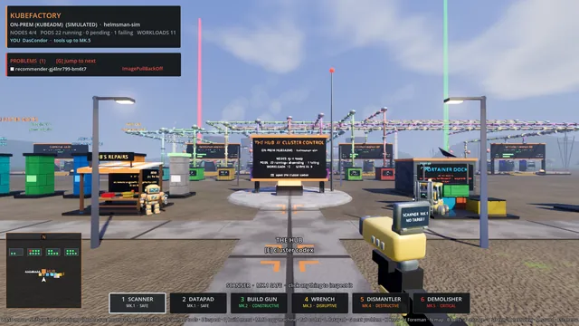
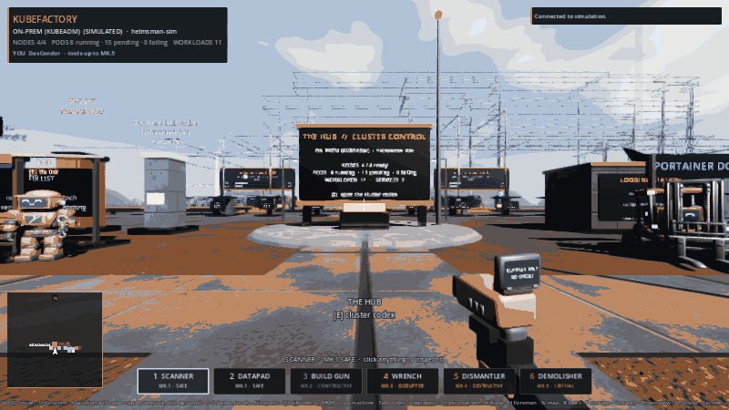

<div align="center">


# 🏭 KubeFactory

### Your cluster is the factory. Go run it.

A first-person factory game for viewing and managing your Kubernetes clusters,
Docker containers and stacks. Built for personal and homelab use.

[Play the browser demo](https://dascondor.github.io/kubefactory/) ·
[Download](https://github.com/DasCondor/kubefactory/releases) ·
**[Explore the wiki](https://github.com/DasCondor/kubefactory/wiki)** ·
[Changelog](https://github.com/DasCondor/kubefactory/wiki/Changelog)

[](https://github.com/DasCondor/kubefactory/releases)
[](https://github.com/DasCondor/kubefactory/actions/workflows/pages.yml)
[](https://godotengine.org)
[](LICENSE)



</div>

## Get started

- **Try it safely:** the [browser demo](https://dascondor.github.io/kubefactory/) uses simulated worlds and connects to nothing.
- **Manage real infrastructure:** download a desktop build from [Releases](https://github.com/DasCondor/kubefactory/releases), then follow the [installation](https://github.com/DasCondor/kubefactory/wiki/Getting-Started) and [connection](https://github.com/DasCondor/kubefactory/wiki/Connections) guides.
- **See how it all connects:** the [connection whiteboard](https://github.com/DasCondor/kubefactory/wiki/Connection-Whiteboard) draws every app and route as an isometric diagram, in 2D or as cards, in every demo world.
- **Start from nothing:** [Clean slate](https://github.com/DasCondor/kubefactory/wiki/Clean-Slate) sets up a Docker host or a Kubernetes cluster (Docker Desktop, kind or k3s) with you. The game checks your machine and gives you an install script to run as administrator.
- **Keep it running for a team:** install the [host service](https://github.com/DasCondor/kubefactory/wiki/Host-Service) on a Docker host or cluster node. It keeps the KubeFactory server running and players connected while Docker or Kubernetes restart.
- **Learn the game:** visit the [wiki](https://github.com/DasCondor/kubefactory/wiki) for controls, tools, connections, the Krew, server mode and more.

> [!IMPORTANT]
> KubeFactory 2.0 is a beta. Check the [known limitations](docs/KNOWN_LIMITATIONS.md)
> and [security guide](docs/SECURITY.md) before connecting real infrastructure.
> Cluster permissions are the security boundary; in-game safeguards do not replace them.

## 🎬 See it in action



The whiteboard in every demo world ([MP4](docs/wiki/media/board-tour.mp4)). One
world at a time:
[Kubernetes cluster](docs/wiki/media/board-kubernetes.mp4) ·
[Home Assistant](docs/wiki/media/board-home-assistant.mp4) ·
[Dev containers](docs/wiki/media/board-dev-containers.mp4) ·
[Media suite](docs/wiki/media/board-media.mp4) ·
[Docker media lab](docs/wiki/media/board-docker-media.mp4) ·
[with the gatherer](docs/wiki/media/board-docker-media-gatherer.mp4).
More walkthroughs: [media dashboards and storage](docs/wiki/media/dashboard-tour.mp4) ·
[VPN routes](docs/wiki/media/vpn-tour.mp4).

## 📚 Docs by topic

The **[wiki](https://github.com/DasCondor/kubefactory/wiki)** is the guide to
KubeFactory, from first launch to administration and development. Start with
the [overview](https://github.com/DasCondor/kubefactory/wiki/Overview),
[getting started](https://github.com/DasCondor/kubefactory/wiki/Getting-Started),
or [documentation index](https://github.com/DasCondor/kubefactory/wiki/Documentation-Index).
The [visual demo guide](docs/wiki/README.md) has screenshots and walkthroughs of
the media stack, VPN routes, port readiness, shared disks, the connection
whiteboard, and phone controls. New: [Clean slate](https://github.com/DasCondor/kubefactory/wiki/Clean-Slate) and the
[host service](https://github.com/DasCondor/kubefactory/wiki/Host-Service).
See the [changelog](https://github.com/DasCondor/kubefactory/wiki/Changelog) for
release history and [Contributing](CONTRIBUTING.md) to help.

## 💻 Run from source

Install Godot 4.3 and run the simulation from the repository root:

```sh
godot --path . -- --demo
```

See the [development guide](https://github.com/DasCondor/kubefactory/wiki/Development-Guide)
and [contribution guide](CONTRIBUTING.md) for setup, building and tests.

## License

[MIT](LICENSE). See [third-party notices](docs/THIRDPARTY.md).

## Support KubeFactory

If you’d like to support KubeFactory’s development, [buy me a coffee](https://buymeacoffee.com/dascondor).
