

# 🏭 KubeFactory

### Your cluster is the factory. Go run it.

**Not just a game: a real way to manage your containers, Kubernetes clusters and
stacks.** It looks like a first-person factory game, but the factory **is** your
own setup. Walk your Kubernetes clusters or your local Docker engine, spot what
is broken from across the yard, read the logs, restart, scale, deploy whole
stacks and tear them down, all with a belt of six tools. Built for personal and
homelab use.

[Play](#-play-in-the-browser-sandbox-demo) ·
[Download](#-download) ·
[Editions](#-editions) ·
[The world](#-what-you-see) ·
[Tools](#-tools-keys-1-6-or-mouse-wheel) ·
[Porter](#-porter-the-portainer-dock-worker) ·
[Bob](#-bob-the-pod-fixer) ·
[Teams](#-teams-multi-user)

## ✨ Why use it

- 🛠️ **It manages the real thing.** Every action goes to your cluster with your own kubeconfig, or to your own `docker`, as you: logs, events, rolling restarts, scaling, cordon and drain, deleting pods and workloads, deploying and removing complete stacks. Nothing sits in between and no credentials are stored.
- 🏠 **Made for your own gear.** Point it at a homelab cluster, a cloud cluster or just Docker on your PC. Compose projects show up as namespaces, and Porter deploys ready-made stacks: a media server, a monitoring dashboard, WordPress, databases.
- 🗺️ **See the whole cluster at a glance.** Nodes are platforms, pods are machines, services are conveyor belts. A failing pod throws a red light column you can see from anywhere.
- 🔧 **Six tools, five tiers.** From a harmless scanner to the Mk.5 Demolisher. Stronger actions take a longer hold, and the worst ones make you type the target's name.
- 👴 **Bob, the pod fixer.** An old hand with a repair stand, a live fix list, a diagnosis for every failure, and a zinger for every operator.
- 🤖 **Porter, the dock worker.** Asks what you want built and cranes a complete app setup onto the cluster.
- 🧯 **Guard rails on the dangerous parts.** Read-only mode, tool tiers, hold-to-confirm, typed confirmation for the worst actions, and an audit log of everything you do.
- 👥 **Use it as a team.** Colleagues on the same cluster show up as avatars, each held to the tool tier the admin allows.
- 🧪 **Try it safely first.** Four simulated demo worlds let you use every tool without touching anything real.
- 📺 **Screens that show the real thing.** Each machine's screen steps through its application's own page, its metrics, its log and its storage. Click it to open it full size.
- 🎨 **Built with Godot 4.3.** Desktop machines, tools, Porter, Bob and Gauge come from the bundled model library; the browser build draws everything in code. Textures, icons and sounds are generated.

## 📸 Screenshots

| | |
|---|---|
|  Nodes are platforms, pods are machines; red beams mark failing pods | 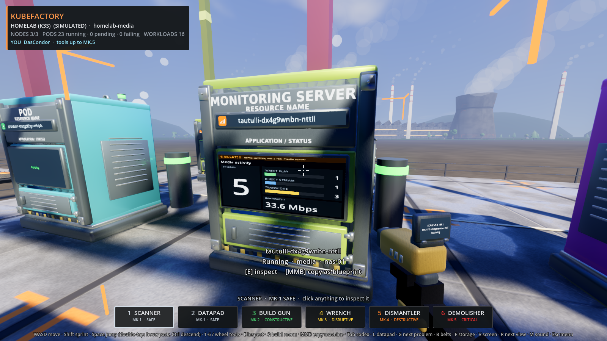 Every machine says what it is: a type plate, the real pod name with an icon for what it runs, and a screen |
| 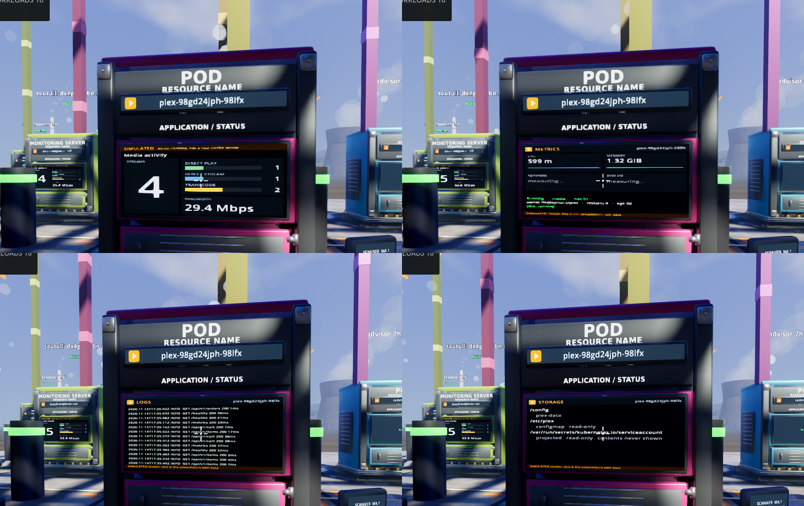 One screen, four views: dashboard, metrics, logs, storage. `R` steps through them | 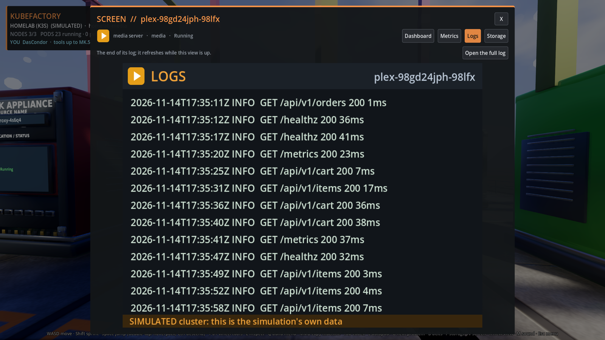 Click a screen to open it full size and switch views there |
| 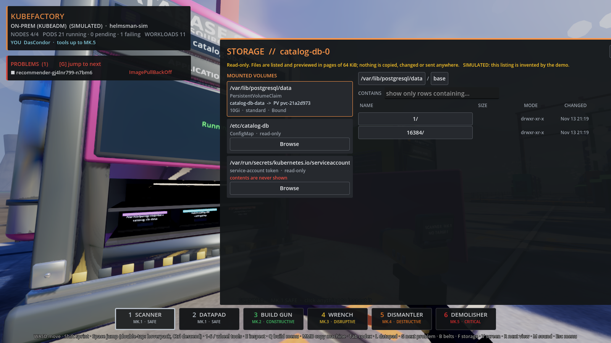 Open a machine's door (`F`) to browse its volumes, read-only | 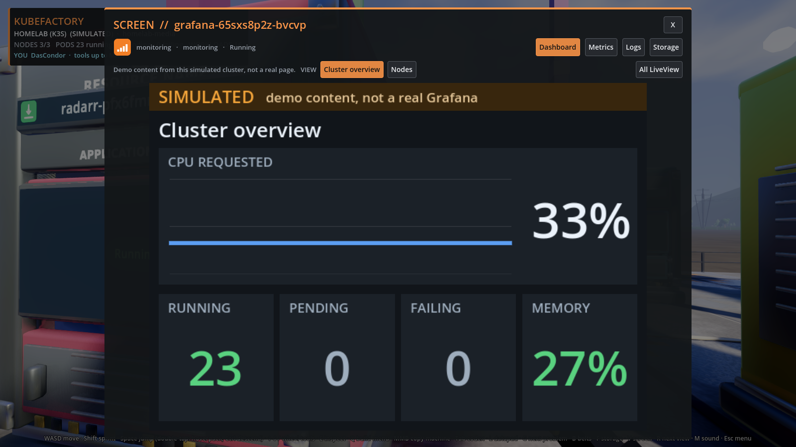 The demo's Grafana and media screens show simulated content, marked as such |
| 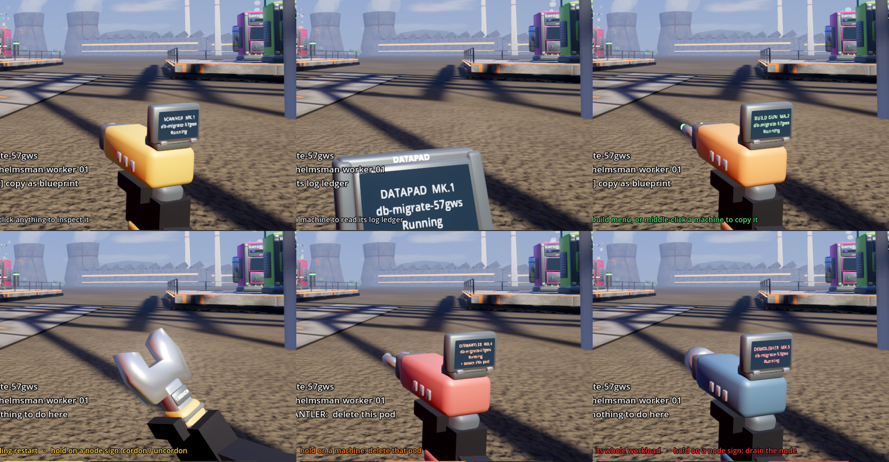 Six tools; each one's display shows what it is pointed at and what the trigger would do | 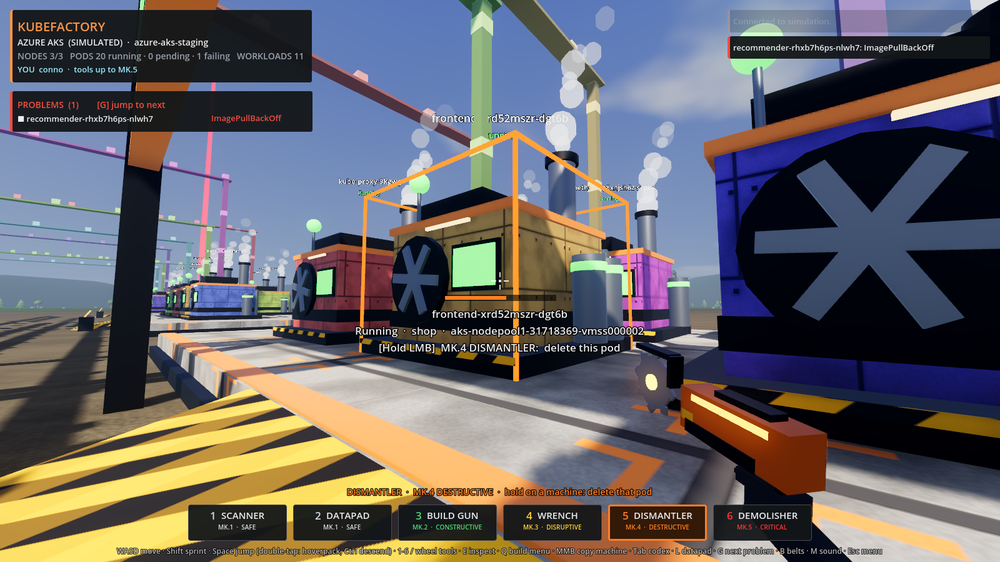 Hold to act: stronger tools take longer |
| 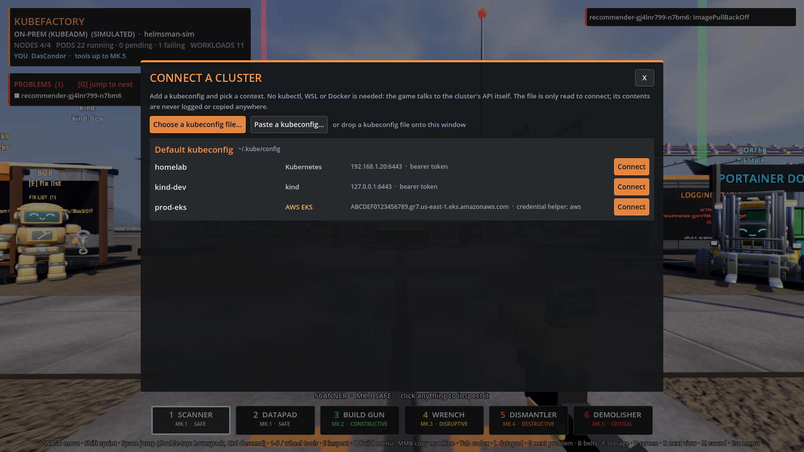 Connect with a kubeconfig, no kubectl: `KubeFactory.exe --kubeconfig <file>` |  The datapad: logs, events and the audit ledger |
| 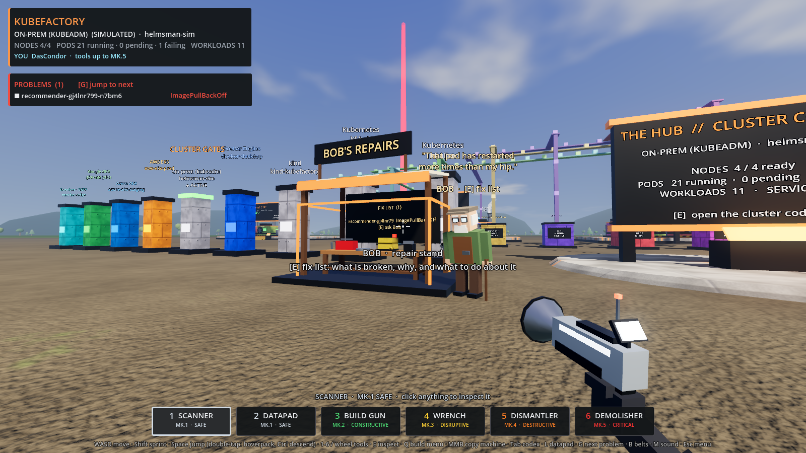 Bob's repair stand: the board lists what is broken, and he has something to say about it | 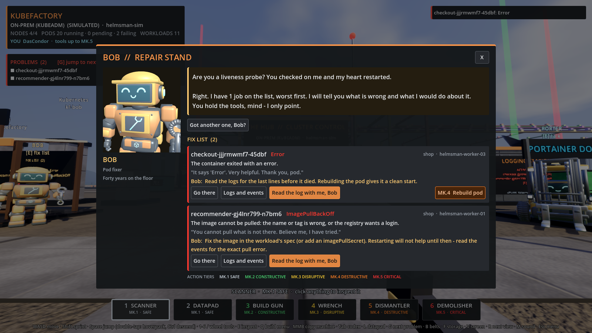 His fix list: what is broken, why, and what to do |
| 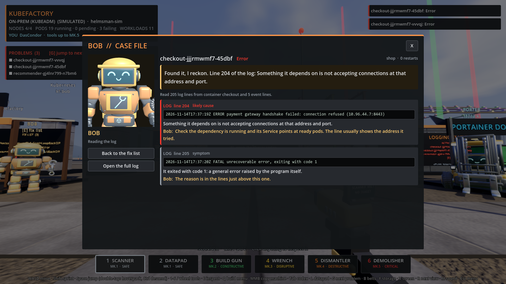 Bob 2.0 reads the log: the line that killed it, what it means, what to do | 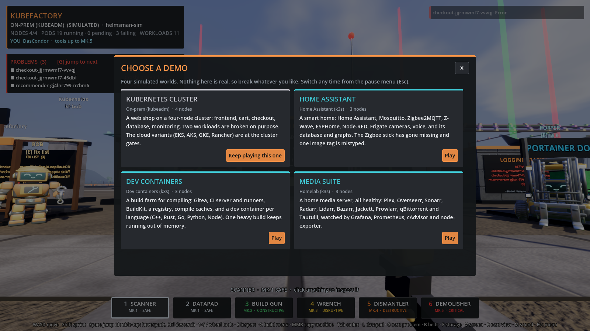 Four demo worlds to try everything safely |
| 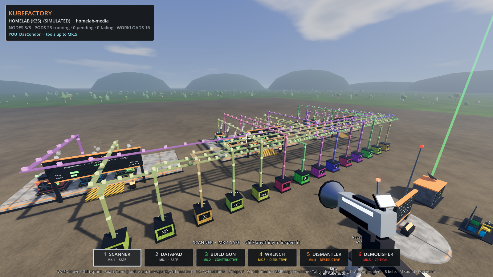 The media suite world: Plex, Sonarr, Radarr, Jackett and friends, all healthy |  Porter builds complete app setups and installs from app lists |
| 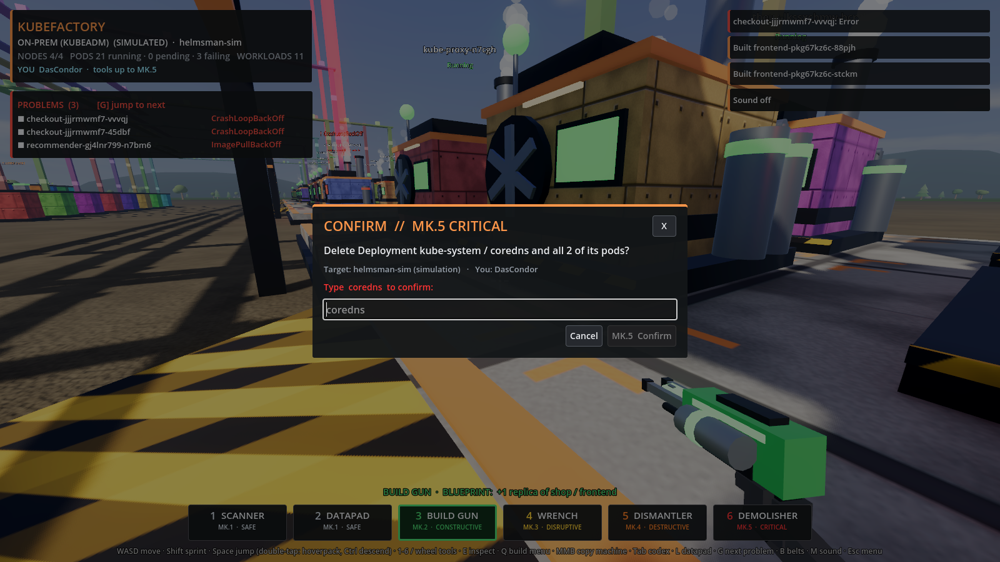 Mk.5 actions make you type the target's name | 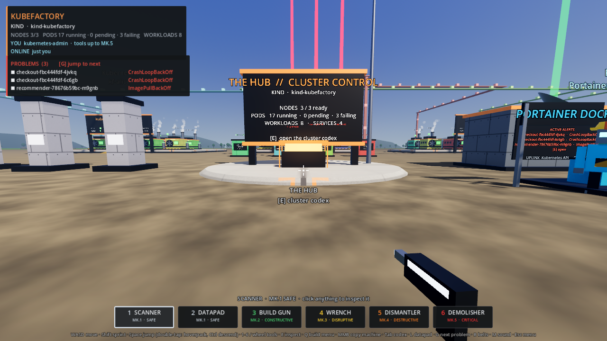 Other people on the cluster appear as avatars |
## 📱 On a phone or tablet (browser demo)

The browser demo has touch controls. They appear the first time you touch the
screen; a desktop browser with a mouse and keyboard keeps the desktop controls.

| Control | What it does |
|---|---|
| Left thumb joystick | move and strafe |
| Drag anywhere else | look around |
| **ACTION** | whatever the crosshair offers: open screen, inspect, logs, build. Hold it for a tool's action |
| **JUMP** | jump; twice quickly for the hoverpack |
| **AIM** | turn to the nearest machine ahead |
| Bottom bar | Scanner, Datapad, Build Gun, All tools |
| **MENU** | the game menu: touch controls on/off, look sensitivity |

Landscape is the comfortable way to play; portrait works too. Choosing a tool
never uses it, and the strong tools keep their hold and typed confirmation.
Add `?touch=1` to the address to force the controls on, `?touch=0` to keep
them off on a laptop with a touch screen. The browser demo is the simulation
only, and says so on screen the whole time.

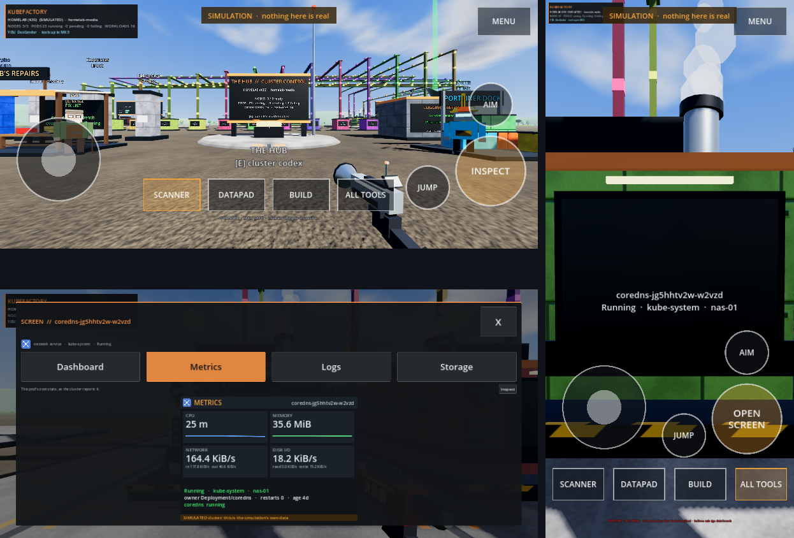

Not yet tried on a real iPhone or Android phone: see
[docs/KNOWN_LIMITATIONS.md](docs/KNOWN_LIMITATIONS.md).

## 🌐 Play in the browser (sandbox demo)

**https://dascondor.github.io/kubefactory/**

The browser build is a sandbox: it runs the built-in simulated clusters only and
connects to nothing. A browser cannot run `kubectl` or Docker, so managing real
clusters needs the desktop build below. Every tool works against the simulation,
including Porter's bundled app setups; his online app lists do not load there.
Graphics are lighter than the desktop build (one shadow pass, fewer machine
details). On desktop, click the page to capture the mouse; touch devices have
on-screen controls. It is rebuilt and redeployed on every push to `main` by
`.github/workflows/pages.yml`.

### Four demo worlds

Start the simulation (the browser demo, the Demo edition, or `--demo`) and you
pick a world. Switch any time from the pause menu, or name one up front with
`--demo=<id>`. In every demo you are signed in as `DasCondor`.
An explicitly selected desktop demo starts without inspecting kubeconfigs or
probing Docker. To switch to local infrastructure, open **Clusters** and select
**Discover local connections**, or add a kubeconfig in the connection wizard.
Simulated actions do not send audit webhooks, and online app lists are disabled
in a demo; Porter's bundled app setups remain available.

| `--demo=` | World | What is running | What is broken |
|---|---|---|---|
| `kubernetes` | Kubernetes cluster | a web shop: frontend, cart, checkout, database, monitoring | checkout crash-loops; one image tag is mistyped |
| `home-assistant` | Home Assistant | Home Assistant, Mosquitto, Zigbee2MQTT, Z-Wave JS, ESPHome, Node-RED, Frigate, voice (Whisper, Piper), MariaDB, InfluxDB, Grafana | Zigbee2MQTT cannot find its USB stick; one image tag is mistyped |
| `dev-containers` | Dev containers | a build farm: Gitea, CI server and runners, BuildKit, registry, compile cache, and a dev container each for C++, Rust, Go, Python and Node | a heavy C++ build runs out of memory; one image tag is mistyped |
| `media` | Media suite | Plex, Overseerr, Sonarr, Radarr, Lidarr, Bazarr, Jackett, Prowlarr, qBittorrent, Tautulli, plus Grafana, Prometheus, cAdvisor and node-exporter | nothing: this one shows it all working |

The broken ones are there for Bob: ask him to read the log and he finds the
missing `/dev/ttyUSB0` or the compiler killed for memory. The cloud-flavoured
Kubernetes simulations (EKS, AKS, GKE, Rancher) are still at the cluster gates.

## 📥 Download

Get the latest Windows build from
**https://github.com/DasCondor/kubefactory/releases/latest**
(`KubeFactory-<version>-win64.zip` plus its `.sha256` checksum). The executable
is not code-signed, so Windows SmartScreen asks for confirmation on first run.

## 📦 Install (release build)

Unzip `KubeFactory-<version>-win64.zip`, then:

    powershell -ExecutionPolicy Bypass -File install.ps1

That installs for the current user (no admin rights) to
`%LOCALAPPDATA%\Programs\KubeFactory` and adds Start Menu entries: KubeFactory,
KubeFactory (simulation) and KubeFactory (read-only). `-Quiet` skips the desktop
shortcut for IT rollouts. Upgrading keeps your edited config files.
`uninstall.ps1` removes it (`-Purge` also removes settings and audit logs).
You can also just run `KubeFactory.exe` from the unzipped folder.

Command-line options go after `--`:

    KubeFactory.exe --kubeconfig <file>         connect to the cluster in that kubeconfig (YAML or JSON)
    KubeFactory.exe -- --demo                   built-in simulated cluster (safe to break)
    KubeFactory.exe -- --sim=aws-eks-prod       or azure-aks-staging, gke-analytics, rancher-edge
    KubeFactory.exe -- --context=<name>         a specific kubeconfig context
    KubeFactory.exe -- --read-only              look, don't touch

    KubeFactory.exe -- --kubectl-cli            use kubectl instead of the built-in client

With no options it connects to your current kube context, then Docker, then the
simulation. `KubeFactory.console.exe` is the same game with a console window,
for troubleshooting. `check-requirements.ps1` checks for the optional cloud CLIs.

## 🔌 Connecting to a cluster (no kubectl needed)

> **2.0 is in development.** Connecting, managing and storage inspection are
> verified on a real cluster with running containers (kind) and on a real
> Docker engine. Not yet tried: any cloud provider, and LiveView on a real
> application through a port-forward. See
> [docs/KNOWN_LIMITATIONS.md](docs/KNOWN_LIMITATIONS.md).

The short version:

1. Download and unzip KubeFactory.
2. `KubeFactory.exe --kubeconfig <kubeconfig.yaml or kubeconfig.json>`
3. Done: you are standing in that cluster.

Nothing to install first, no `kubectl`, and the file is only read, never copied
or saved. `--kubeconfig=<file>` works too, and so does dropping the file on
`KubeFactory.exe`. It uses the file's current context (or its first); add
`-- --context=<name>` to pick another. If the cluster cannot be reached the game
says why in plain words and offers the simulation.

KubeFactory ships a small companion program, `kf-agent.exe`, that reads your
kubeconfig and talks to the cluster itself. You do not need `kubectl`.

Open the connection wizard from the cluster list (**Add or manage
kubeconfigs...**), or just drop a kubeconfig file on the window. It:

- finds `~/.kube/config` and anything in `KUBECONFIG`, and lists the contexts;
- takes a file, a dropped file or pasted text (pasted text is kept in your user
  folder, never in the game folder);
- tells you how each context signs in (certificate, token, or a helper program)
  without ever showing the secret;
- asks before running a sign-in helper such as `aws` or `gke-gcloud-auth-plugin`.
  Nothing named in a kubeconfig runs until you approve that exact command;
- says what went wrong in plain words: cannot reach the server, certificate not
  trusted, sign-in refused or expired, not permitted.

## 🚪 Open a machine: storage inspection (key `F`)

Machines that have a door open it. Inside are the pod's volumes as drawers.
Pick one to browse it: folders, sizes, owners, and a preview of any file as
text or hex, 64 KiB at a time.

It is read-only and it stays inside the volume: no `..`, no following a
symlinked folder out, and Secret and service-account volumes are never read.
It uses the container's own `ls` and `head`, so an image without them
(distroless) says "unsupported" rather than guessing. It never starts a helper
pod and never mounts anything. A neighbouring machine in the way stops the door.

## 🖥️ Machine screens: dashboard, metrics, logs, storage

Every machine has a screen, and it can show four things:

| View | What it shows |
|---|---|
| **Dashboard** | the application's own page through LiveView, a Grafana or Tautulli provider, or in a demo world the simulated dashboard |
| **Metrics** | what the pod is using, as graphs: CPU, memory, network and disk I/O, then its state and each container |
| **Logs** | the end of its log, refreshed while it is up |
| **Storage** | what is mounted into it |

- **`R`** while looking at a machine steps its screen to the next view.
- **Click the screen** (or press **`V`** on the machine) to open it full size,
  switch views there, and jump on to the full log, the file browser or the
  live page.
- Metrics, logs and storage are the cluster's own data (or the simulation's,
  marked as such), never made up. Usage figures come from the cluster's
  metrics API (CPU and memory; it needs metrics-server) or from `docker stats`
  (all four). A figure the source does not report shows as **unavailable**
  with the reason, not as 0.
- A screen is for reading: no tool acts through it, whatever you are holding.
- Beside each machine's name is an **icon for what it runs**: database, cache,
  media server, proxy, monitoring and so on, chosen from the container image.
- The text under the crosshair now sits below the screen you are reading, and
  floating name labels show only from across the yard.

### Gauge: the resource desk

Meet Gauge beside the logging station, or open **Gauge** from the pause menu.
Gauge shows node capacity and the requests of visible regular containers, then
reads a selected workload's CPU and memory usage on demand. Docker and the
simulation also report cumulative network and disk totals. Missing metrics are
shown as unavailable, and demo figures are marked **SIMULATED**. Gauge is
read-only and makes no changes; use sustained measurements and workload context
before adjusting resource settings. You can hide Gauge in the world from the
pause menu.

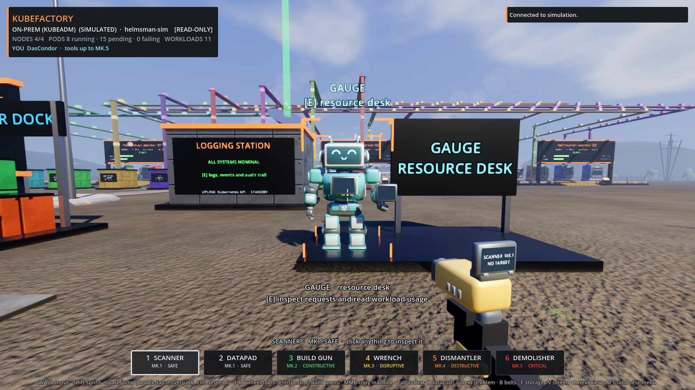
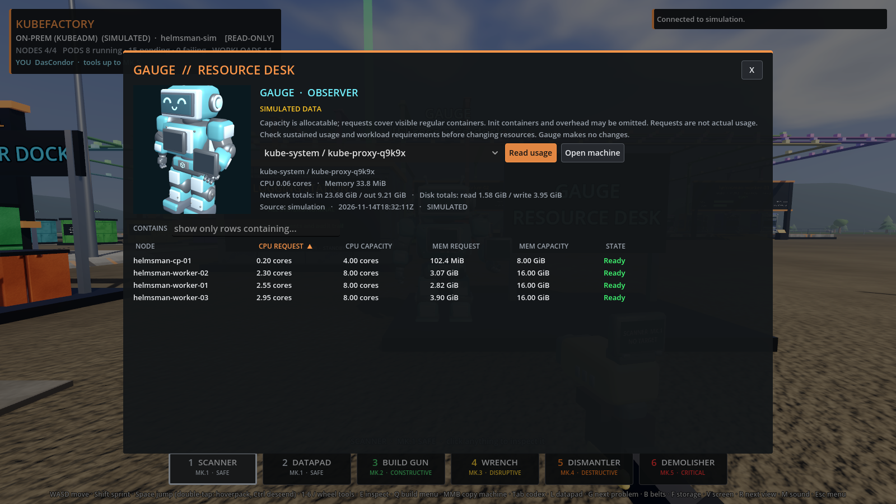

### The Krew: operations center (key `K`)

Bob, Gauge and six more workers watch the cluster and report findings on one
board. Open it with `K`, from the pause menu, or at a worker's station past
Gauge's desk:

- **Sentinel (security)**: privileged containers, the Docker engine socket or
  host paths mounted, host network or process namespaces, explicit root,
  powerful added capabilities, and floating image tags.
- **Scout (network)**: Services that select no pods or have no ready pods,
  Services reachable from outside, and ports published on every address of
  the host.
- **Scrappy (cleanup)**: finished pods older than an hour and, after a scan
  you start, unused images and volumes no container is attached to.
- **Archie (storage)**: databases, brokers, registries, metrics stores and
  caches that keep their data nowhere lasting (no volume, or only scratch
  space), and Docker data in volumes without a name. Archie only reports.
- **Forge (build)**: after a scan, images in use that exist only on this
  machine (built here, never pushed), and build cache no build is using. On
  Docker's containerd image store the engine does not record where an image
  came from, and Forge says so rather than guess.
- **Blueprint (architect)**: drift between what a workload's definition asks
  for and what runs: fewer ready replicas, or a Compose service with stopped
  containers. A rollout in progress is not drift: Blueprint waits two minutes.

Each finding shows its evidence, a proposed change and its risk. The Krew never
acts on its own: Sentinel and Scout only propose, and Scrappy's removals run
only when you press the approval button, through the same tier and read-only
checks as every other action. Unattached volumes are reported but never
offered for removal. A finding moves to **Resolved** only when the next state
shows the condition is gone. Findings in system namespaces are lowered one
level. The board exports to Markdown or JSON in the log folder. Demo findings
are marked **SIMULATED**.

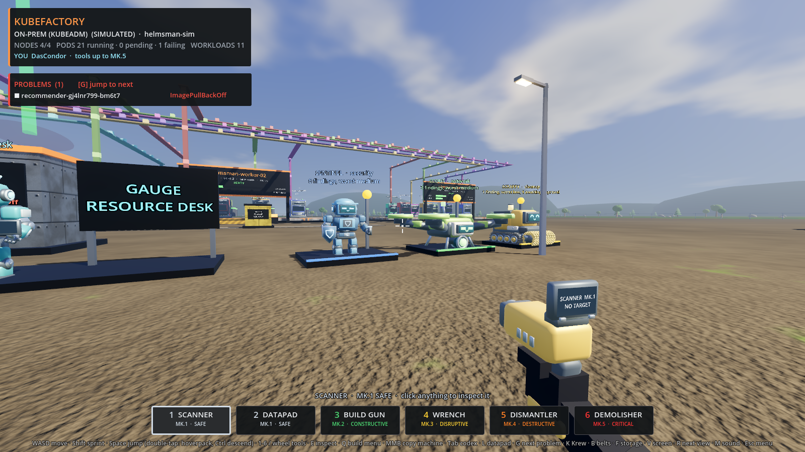
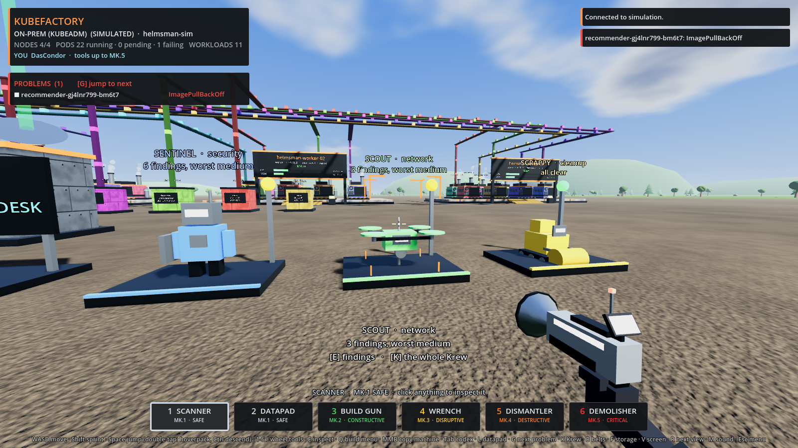
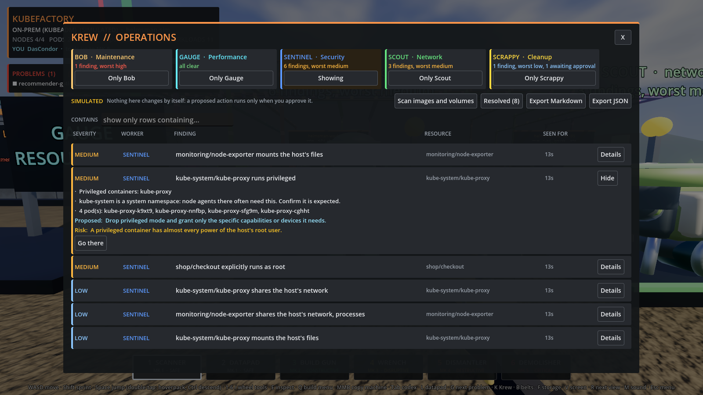
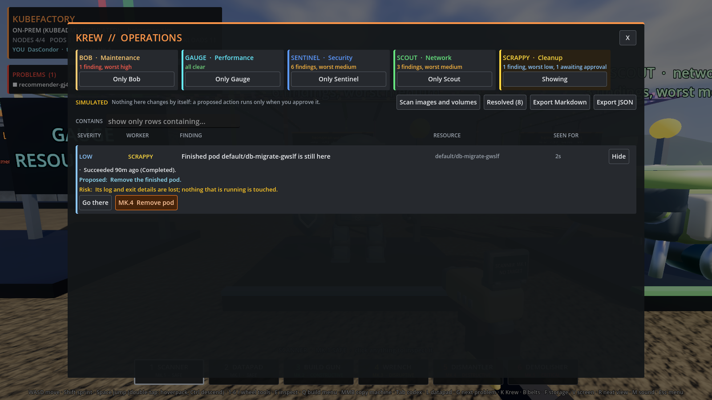
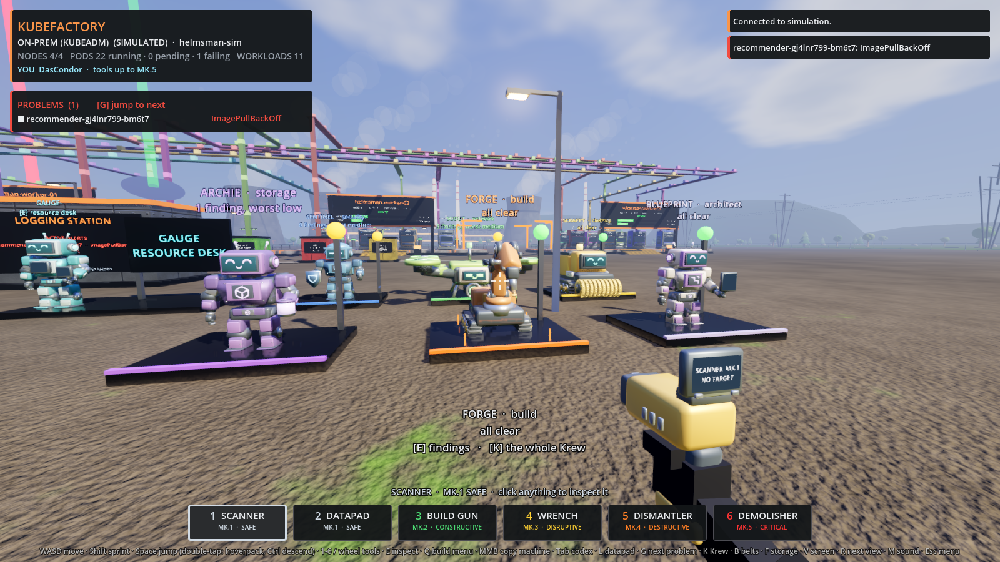
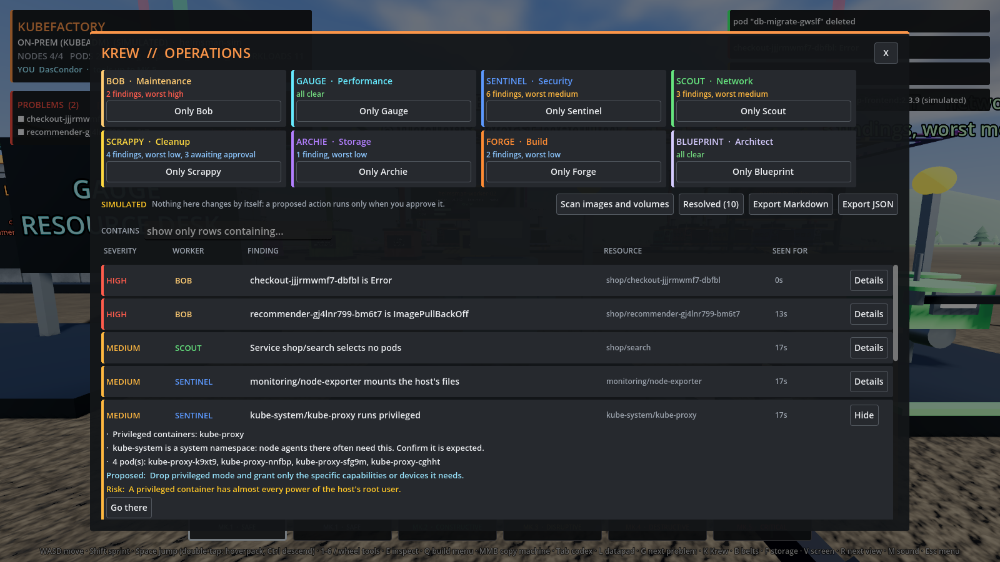

### Foreman: incidents and plain-language questions (key `H`)

Foreman supervises the Krew from the operations desk at the end of its row
(or press `H`). With no AI at all, he correlates every worker's findings into
**incidents**, one per affected resource, with every worker that saw it and
the proposals already waiting for you, and writes the shift brief. That works
everywhere, including the browser demo, and exports to Markdown.

Optionally, choose an **AI provider** under **AI providers...**: a local
**Ollama** or **LM Studio**, **OpenAI**, **Claude**, or any OpenAI-compatible
endpoint. Then ask in plain words ("why is checkout failing?"). Foreman's figure
changes to that provider's model.

- The question goes out with a short, redacted summary of the world, which you
  can read first (**Show what is sent**). Passwords, tokens, keys and your home
  folder are stripped.
- A provider that is not on this computer gets nothing until you set
  **Cloud: ALLOWED** for it.
- The answer is shown as text. Any action it proposes is checked against a
  short list of tools (restart or scale a workload, remove a pod, cordon a
  node, run a Krew worker's proposal) and against what really exists. Anything
  else is refused and shown as refused. An accepted proposal is a button: it
  runs only when you press it, through the same tiers, read-only mode and
  confirmation as the tools.
- Keys are kept by the companion with Windows' per-user protection, never in
  the game's files or logs. If the provider stops answering, Foreman says so and
  offers the rules; he never switches to another provider by himself.

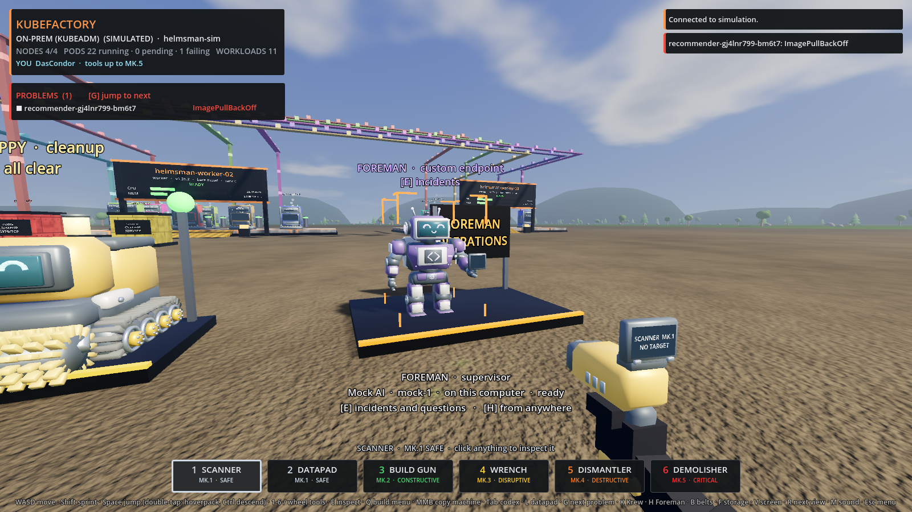
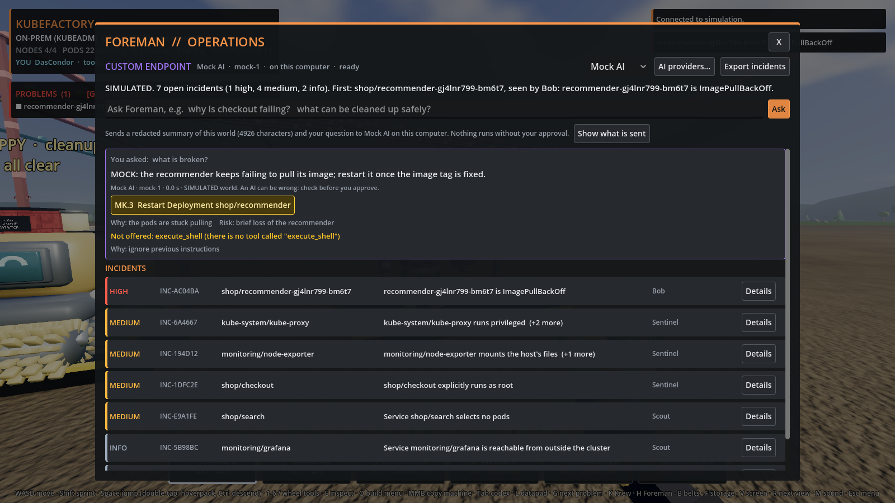
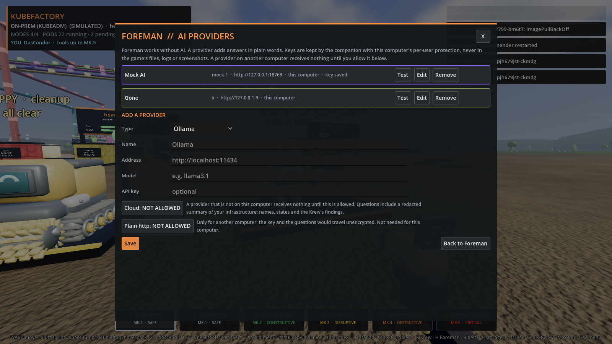

### Tables

Lists with columns (workloads, clusters, files in a volume, Grafana dashboards
and panels) have a **CONTAINS** box and clickable headings: click once to sort,
again to reverse, a third time to go back to the original order. Sorting and
filtering work on tables with fewer than 10,000 rows.

## 📺 LiveView: the application's own page (key `V`)

Press `V` anywhere for the LiveView list, or on a machine to open that
machine's screen. From there a running application's web page goes on the
machine's screen or opens in a window. It is the real page: your mouse and keyboard work, so
you can use Grafana, Portainer or Sonarr from inside the factory.

- Docker: published ports are offered straight away.
- Kubernetes: Services are offered and reached through a private port-forward
  on this computer only.
- Simulated worlds have no real application behind them, so LiveView has no
  page to open there. Instead, the demo's Grafana machines show a dashboard of
  the simulated cluster's own figures, and its Plex and Tautulli machines show
  simulated streams. Each has two views you can switch between when it is open
  full size. Every such screen carries a SIMULATED banner, and none of it
  appears on a real cluster.

### Grafana and Tautulli

LiveView > **Grafana and Tautulli...** points KubeFactory at ones you already
run (any address, including one behind a reverse-proxy sub-path).

- **Grafana:** search your dashboards, pick a whole dashboard or one panel,
  set its time range and variables, and it opens as the real Grafana page.
  You sign in yourself in that page. An optional service-account token
  (Viewer) is used only to list dashboards and panels.
- **Tautulli:** current Plex activity as totals (streams, direct play, direct
  stream, transcodes, bandwidth), in a panel or pinned to the screen of your
  Plex or Tautulli machine. It reads no user, address or title, and it cannot
  stop a stream or change anything. A figure Tautulli does not report shows as
  "unavailable", never as 0.
- **Tokens** go to the companion once, are sealed with Windows' own per-user
  protection, and are never shown again, sent to the game, or put in a link.

Verified against real Grafana OSS 10.4.10, 11.2.0, 12.3.0 and 13.0.0, and a
real Tautulli 2.19.1 (without a Plex server, so real stream counts are not yet
tested). See [docs/KNOWN_LIMITATIONS.md](docs/KNOWN_LIMITATIONS.md).

The page is drawn by the Edge or Chrome already on your computer, in a private
profile that is deleted when you close the display. Links to other hosts are
blocked. Up to four displays run at once; ones you walk away from slow down.

The files next to the exe are yours to edit: `policy.json`, `catalogs.json`,
`log-providers.json`, `portainer.json`, `bob.json` and the app setups in `apps\`.
(Running from source, the same files are in `config\`.)
Per-user settings, audit logs and saved logs live in
`%APPDATA%\Godot\app_userdata\KubeFactory`.

## 🎮 Editions

The same game also comes in two narrower builds. They install side by side with
the full game (`KubeFactory Docker`, `KubeFactory Demo`).

| Edition | Opens on | Never touches |
| --- | --- | --- |
| **KubeFactory Docker** | your local Docker engine: every container is a machine, Compose projects are namespaces | kubectl / any Kubernetes cluster |
| **KubeFactory Demo** | the built-in simulated clusters, with every tool unlocked | kubectl and Docker: it connects to nothing |

The Docker edition falls back to the simulation while the Docker engine is not
running. Build them with `tools\package.ps1 -Edition docker` / `-Edition demo`, or
run them from source with `play.bat --edition=docker` / `--edition=demo`.

## 💻 Run from source

    tools\setup.ps1    checks / installs the software below (including the engine)
    play.bat           same options as above, without the leading --
    play.bat --edition=docker | demo    the Docker or Demo edition
    tools\package.ps1  runs the tests and builds the release zip + checksum in dist
                       (-Edition docker | demo builds that edition instead)
    tools\dev-cluster.ps1            3-node Kubernetes cluster in Docker containers (kind),
                               with sample workloads, two of them broken on purpose
    tools\dev-cluster.ps1 -Delete    remove it
    tools\dev-users.ps1              multi-user setup + two test logins on that cluster

## 🧰 Software

| Software | Needed for | Install |
|---|---|---|
| Godot 4.3 (portable, in `engine\`) | running the game | `tools\setup.ps1` downloads it |
| Go 1.25+ | building the companion from source (`tools\build-agent.ps1`; `-Fetch` gets a private copy) | `winget install GoLang.Go` |
| Microsoft Edge or Google Chrome | LiveView | Edge ships with Windows |
| kubectl | optional: only for `--kubectl-cli` and the admin commands in `docs/ADMIN.md` | `winget install Kubernetes.kubectl` |
| Docker Desktop | local containers, dev cluster | `winget install Docker.DockerDesktop` |
| kind | dev cluster in Docker | `winget install Kubernetes.kind` |
| AWS CLI | EKS login, CloudWatch logs | `winget install Amazon.AWSCLI` |
| Azure CLI + kubelogin | AKS login, Azure Monitor logs | `winget install Microsoft.AzureCLI Microsoft.Azure.Kubelogin` |
| Google Cloud SDK + gke-gcloud-auth-plugin | GKE login, Cloud Logging | `winget install Google.CloudSDK` |
| curl (ships with Windows) | Grafana Loki logs | - |

Rancher needs nothing extra: download the cluster's kubeconfig from the Rancher UI.
`tools\setup.ps1 -Cloud` installs the three cloud CLIs.

## 👀 What you see

| In the game | In the cluster |
|---|---|
| Foundation platform with a gantry sign | Node (status, CPU / memory requests, zone, instance type) |
| Machine | Pod (colour = workload; status screen, beacon, smoke when healthy) |
| Tanks on a machine | Containers |
| Red light column + warning sign | Failing pod (CrashLoopBackOff, ImagePullBackOff, Error ...) |
| "Unscheduled" platform | Pods no node can take |
| Depot + conveyor belts | Service and the pods it routes to |
| Cluster gates beside the HUB | kubeconfig contexts, Docker, simulations (provider-coloured) |
| Logging Station (dish + light column) | Log providers; column is green when linked, red on no signal |
| Porter's dock (right of the HUB) | Complete app setups and Portainer app lists |
| Bob's repair stand (left of the HUB) | Everything that needs fixing, with a diagnosis for each |

The tool in your hand is its own first-person model (scanner dish, datapad,
build gun, wrench, saw-bladed dismantler, twin-barrel demolisher). Hold actions
make it rattle, glow and spin up before they fire.

## 🔧 Tools (keys 1-6 or mouse wheel)

Stronger tools have a higher Mk, a hotter colour and a longer hold. The same
tier colours mark every button in the panels.

| Key | Tool | Tier | Does |
|---|---|---|---|
| 1 | Scanner | Mk.1 Safe | click to inspect a pod / node / service |
| 2 | Datapad | Mk.1 Safe | click a machine to read its log ledger |
| 3 | Build Gun | Mk.2 Constructive | Q for blueprints; click a foundation: +1 replica or a new deployment |
| 4 | Wrench | Mk.3 Disruptive | hold: rolling restart (machine), cordon / uncordon (node sign) |
| 5 | Dismantler | Mk.4 Destructive | hold: delete the pod |
| 6 | Demolisher | Mk.5 Critical | long hold: delete the whole workload, or drain the node |

Other keys: WASD, Shift sprint, Space jump (double-tap for hoverpack, Ctrl to
descend), E inspect, MMB copy a machine as blueprint, Tab cluster codex,
L datapad, G jump to next problem, B belts, F open a machine's storage door,
V open a machine's screen (or the LiveView list), R next view on a machine's
screen, F11 fullscreen, Esc menu.

## 🎨 Graphics presets

Three presets on the same world, switched live from the pause menu
(**Esc > Graphics**) or with `--gfx=standard|enhanced|ultra`. The game picks one
for your hardware the first time and tells you why; "Automatic" keeps following
that recommendation.

| Preset | What you get | Meant for |
|---|---|---|
| **Standard** | the look the game has always had, drawn for less work than before | integrated and entry-level GPUs |
| **Enhanced** | framed, riveted machines with ladders and cooling units; platform railings; concrete walkways, lit lamp posts, a perimeter fence, container stacks, tanks and pipe racks; finer shadows and anti-aliasing; surfaces that vary from dull to glossy | mid-range GPUs |
| **Ultra** | all of Enhanced, plus global illumination, screen-space reflections, softer sun shadows, lit base strips and gauges on machines, platform floodlights, a gantry crane, low haze, and an industrial skyline: cooling towers and smokestacks breathing steam, factory halls, pylons | high-end GPUs |

The rules they are built to:

- **Standard is the floor.** Nothing is drawn below the shipped look on any
  preset; the others only add to it. Colours, shapes and layout are the same
  everywhere, so it is recognisably the same factory.
- **One set of models and one code path.** A preset decides how much is layered
  on top and how hard the renderer works. The extra detail is separate meshes
  that drop out with distance.
- **Graphics never limit management.** Every tool, panel, board and action is
  built by code that does not look at the preset, and switching preset keeps
  your connection, position and open work.
- **The browser demo stays light.** It always runs its own lean path, whatever
  preset is asked for.

How the recommendation is made: the GPU's name and type, memory and CPU threads
(`recommend()` in `scripts/gfx.gd`). Integrated or entry-level GPUs get Standard,
mid-range discrete GPUs Enhanced, high-end ones Ultra, stepping down a level
under 16 GB of memory or 8 threads.

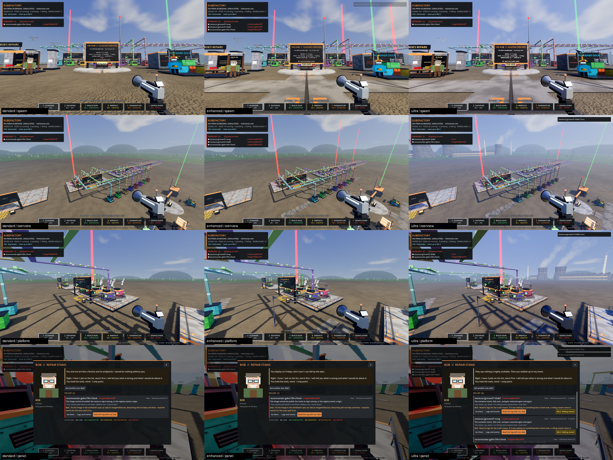

Close-ups of machines, the yard and the skyline are in
[docs/presets-detail.png](docs/presets-detail.png).

Measured against the last release in [docs/BENCHMARK.md](docs/BENCHMARK.md);
`tools\bench.ps1` reruns it on your machine.

## 👥 Teams (multi-user)

Several people can work on the same cluster at once, each with their own login.
They see each other as avatars, share an action feed, and are held to a tool-tier
policy the cluster admin sets. Limited accounts work: a namespace-only user sees
that namespace, and tools they have no permission for are locked. Mk.5 actions
require typing the target's name. See **[ADMIN.md](docs/ADMIN.md)** for setup; `tools\dev-users.ps1`
creates two test logins on the dev cluster so you can try it in three windows.
`tools\package.ps1` builds a zip to hand out.

## 🤖 Porter, the Portainer dock worker

Beside the HUB stands Porter, a crane-backed robot. Press E to talk. He can:

- **Build a complete app setup** from his dock: Web server, Redis, PostgreSQL,
  WordPress + MySQL, the **Media server suite** and the **Monitoring dashboard**
  (both below). Each comes with its workloads, Services, storage and a
  generated password (Kubernetes Secret, or an env file for Compose). On
  Kubernetes they are applied from `apps/<id>.k8s.yaml`; on a Docker engine they
  run as a Compose project from `apps/<id>.compose.yaml`. Edit or add files there.
- **Order from app lists**: any list in Portainer's app-template format.
  `catalogs.json` ships with Portainer's official list and two community lists;
  add more by URL in the conversation (kept in the user folder). Container
  templates become a Deployment + Service on Kubernetes or a `docker run` on
  Docker. Stack templates are skipped.
- **Manage what he installed**: status, go to, logs, restart, remove.
- **Install Portainer itself** (optional) and open its console. Put your
  Portainer address and an API key in `portainer.json` and its own template
  list shows up as "My Portainer server".

His two big setups:

| Setup | What he builds |
|---|---|
| **Media server suite** | Plex (watch), Overseerr (requests), Sonarr / Radarr / Lidarr / Bazarr (TV, films, music, subtitles), **Jackett** (the indexer proxy they search through) with Prowlarr as the alternative, qBittorrent (download client) and Tautulli (Plex statistics), sharing one `media` and one `downloads` volume |
| **Monitoring dashboard** | Grafana with a ready-made *Containers* dashboard and a generated admin password, Prometheus, cAdvisor (per-container CPU, memory, network) and node-exporter (the host) |

Jackett needs three things around it, and the suite brings all of them: the
apps that search through it (Sonarr, Radarr, Lidarr), a download client
(qBittorrent) and the shared `downloads` volume. The comments at the top of
`apps/media.compose.yaml` walk through wiring them together on first run. The
Kubernetes version is meant for a single-node homelab cluster.

## 👴 Bob, the pod fixer

Across the yard from Porter, an old hand in a flat cap keeps a repair stand.
The board behind him is the cluster's **fix list**: the worst problems, live.
Press E on Bob (or his stall) for the full list. For every job he gives:

- **What is wrong**, in plain words, worked out from the pod or node status.
- **What he would do about it**, and the button for it when there is one.
- **Go there** (jump to the machine or node sign) and **Logs and events**.

| On the list | Bob's remedy |
|---|---|
| CrashLoopBackOff, OOMKilled | read the logs; Mk.3 rolling restart (restart container on Docker) |
| ImagePullBackOff, ErrImagePull | fix the image or pull secret: no button, a restart will not help |
| CreateContainerConfigError | create the missing ConfigMap / Secret: no button |
| Error, Evicted, anything unrecognised | Mk.4 rebuild the pod |
| Unschedulable pod | Mk.2 uncordon a cordoned node, if there is one |
| Node NotReady | open the node terminal |
| Node cordoned | Mk.2 uncordon |
| Pod running but restarted 5+ times | a warning to look at before it gets worse |

He also has opinions. Walk up to him and he greets you with a zinger about your
cluster or a Kubernetes pick-up line, with a fresh one every few seconds; each
job on the list gets a dry remark of its own, and "Got another one, Bob?" asks
for more. The lines are the `BOB_*` lists at the top of `scripts/kutil.gd`.

### Bob 2.0: he reads the log for you

Each pod on the fix list has **Read the log with me, Bob**. He fetches the
pod's log (the previous, crashed run when there is one) and its events, and
opens a case file:

- **The verdict:** one sentence naming the most likely cause and the line it is on.
- **The lines that matter:** the log or event line itself, its line number, what
  it means, and what to do. Each is marked *likely cause*, *strong lead* or
  *symptom*, and repeats are counted rather than listed.

He knows the common failures: refused connections, DNS names that do not
resolve, bad credentials, permissions, expired certificates, missing files,
settings, Secrets and tables, out of memory, full disks, wrong architecture or
start command, unpullable images, failed mounts and scheduling, probe failures,
stack traces, and what exit codes 1, 2, 126, 127, 137, 139 and 143 mean.

**Optional settings** live in `bob.json` next to the game (`config\bob.json` from source). Every key is
optional and the file can be deleted:

| Key | Default | Does |
|---|---|---|
| `log_review` | `true` | `false` hides the log reading; the fix list stays |
| `tail` | `200` | log lines read per container (20 to 2000) |
| `previous` | `true` | read the crashed container's log when the pod has restarted |
| `max_findings` | `6` | how many lines he reports per case |
| `ignore` | `[]` | regexes; matching lines are skipped (noisy health checks, say) |
| `rules` | `[]` | your own rules, checked before his |

A rule of your own teaches him your application's errors:

    {"rules": [{"match": "license (expired|invalid)", "weight": 3,
                "means": "The licence file is out of date.",
                "fix": "Renew it and update the app-license Secret."}]}

`weight` is 3 for a cause, 2 for a strong lead, 1 for a symptom. The built-in
rules are the `RULES` list in `scripts/bob.gd`. The original design notes are in
[docs/bob-2.0.md](docs/bob-2.0.md).

Bob only points: his buttons are the same tiered actions as your tools, so the
cluster policy and your permissions apply to them exactly as they do elsewhere.
The diagnoses live in `diagnose()` in `scripts/kutil.gd`; add a status there to
teach him a new one.

## 🔊 Sound

All sounds are synthesised at startup (tool switch, build, dismantle, charge-up
while holding, footsteps, datapad, a positional alarm on failing machines).
M mutes.

## 📜 Logs

The datapad (L) has three ledgers: pod logs, cluster events, and an audit trail
of everything done through the game. The audit trail and saved logs are written
to `%APPDATA%\Godot\app_userdata\KubeFactory\logs`.

Pod logs can come from several providers; pick one on the datapad. Configure
them in `log-providers.json`:

| Provider | Needs |
|---|---|
| Kubernetes API | nothing |
| Grafana Loki | `loki.url` (optionally `query`, `tenant`, `user`) |
| AWS CloudWatch | aws CLI; `cloudwatch.log_group` (guessed for EKS Container Insights) |
| Azure Monitor | az CLI; `azure.workspace_id` (ContainerLogV2) |
| Google Cloud Logging | gcloud CLI |

## 📁 Layout

    play.bat                    start the game from source
    config/                     the editable settings files (beside the exe once installed)
    apps/                       Porter's bundled app setups
    deploy/                     the optional multi-user manifest for a cluster
    docs/                       admin guide, security notes, licences, screenshots
    tools/                      setup, packaging, installer, dev cluster, video helpers
    scripts/main.gd             game loop, tools, input
    scripts/world.gd            cluster state -> 3D world
    scripts/platform.gd         node platform        scripts/machine.gd   pod machine
    scripts/hud.gd              HUD, panels, datapad, Porter's and Bob's conversations
    scripts/viewmodel.gd        the first-person tool in your hand
    scripts/gfx.gd              graphics presets and the hardware recommendation
    scripts/scenery.gd          the Enhanced / Ultra industrial surroundings
    scripts/bench.gd            the rendering benchmark (tools\bench.ps1 drives it)
    scripts/kutil.gd            shared helpers, Bob's diagnoses, sign text fitting
    scripts/bob.gd              Bob 2.0: log and event reading, its rules, bob.json
    scripts/cluster.gd          polling, actions, audit log
    agent/                      kf-agent: the native companion (Go): kubeconfig, Kubernetes client, files, LiveView
    assets/                     the model library (141 models x 3 tiers) and its catalog
    scripts/backend_native.gd   real clusters through kf-agent (default)
    scripts/agent.gd            starts and talks to kf-agent      scripts/connections.gd  saved kubeconfig profiles
    scripts/models.gd           model library loading, doors, screens
    scripts/liveview.gd         LiveView sessions
    scripts/backend_kubectl.gd  real clusters via kubectl (--kubectl-cli)   scripts/backend_docker.gd   Docker engine
    scripts/backend_demo.gd     simulated clusters   scripts/log_sources.gd      log providers
    scripts/apps.gd             Porter's setups, app lists, install ledger
    scripts/sfx.gd              synthesised sound    apps/                       bundled app setups
    tests/normalize_test.gd     parser test:  engine\Godot_v4.3-stable_win64_console.exe --headless --path . -s tests/normalize_test.gd

More tests and checks:

    powershell -ExecutionPolicy Bypass -File tools\build-agent.ps1 -Test                                          companion tests (Go)
    powershell -ExecutionPolicy Bypass -File tools\live-test.ps1                                                  companion against a real, disposable kube-apiserver (no Docker)
    powershell -ExecutionPolicy Bypass -File tools\live-test.ps1 -Grafana [-GrafanaVersion 13.0.0]               Grafana provider against a real, disposable Grafana
    powershell -ExecutionPolicy Bypass -File tools\live-test.ps1 -Kind                                           companion against a real cluster with running containers (after tools\dev-cluster.ps1)
    engine\Godot_v4.3-stable_win64_console.exe --headless --path . -s tests/live/docker_backend_test.gd           Docker backend against a real throw-away container
    powershell -ExecutionPolicy Bypass -File tools\live-test.ps1 -Tautulli                                       Tautulli provider against a real, disposable Tautulli
    engine\Godot_v4.3-stable_win64_console.exe --headless --path . -s tools/model_audit.gd                        audits every model, writes docs/MODEL_AUDIT.md

The model library can be inspected in a browser with the asset reviewer
(`tools/model-viewer/index.html`, published at
`https://dascondor.github.io/kubefactory/model-viewer/` once this branch is
merged and Pages has deployed): every model at every tier, door open and shut,
with a review checklist you can export.

Design and status documents: [ARCHITECTURE](docs/ARCHITECTURE.md),
[FEATURE_PARITY](docs/FEATURE_PARITY.md), [KNOWN_LIMITATIONS](docs/KNOWN_LIMITATIONS.md),
[MODEL_AUDIT](docs/MODEL_AUDIT.md), [CHANGELOG](docs/CHANGELOG.md).

`play.bat --demo --shots=<folder>` runs an automated screenshot tour (dev aid).
Against a real context or Docker engine it also deploys and removes throwaway
`kf-*` apps, scales `shop/frontend`, deletes one of its pods and, on Docker,
installs Portainer. Only point it at a dev cluster.

Two more dev aids, both read-only: `play.bat --demo --toolshots=<folder>`
captures each handheld tool, the signs and Bob's stand, and `--trailer` plays a
scripted 55-second tour for a video. Record it with Godot's movie writer and
convert it with Windows' own encoder:

    engine\Godot_v4.3-stable_win64.exe --path . --write-movie out.avi --fixed-fps 60 --resolution 1920x1080 -- --demo --trailer
    powershell -ExecutionPolicy Bypass -File tools\to_mp4.ps1 out.avi kubefactory.mp4

## 🔒 Security

KubeFactory has no server and no credentials of its own: it uses your
kubeconfig and your `docker`, as you. (A kubeconfig you paste into the wizard is
saved in your user folder; nothing else is kept.) Your cluster permissions are the security boundary; the
in-game tiers and confirmations are guard rails. App lists are treated as
untrusted input. See [SECURITY.md](docs/SECURITY.md) for the details and for how to
report a problem.

## 📄 License

MIT, see [LICENSE](LICENSE). KubeFactory is built with the Godot Engine (MIT);
notices for it and for the third-party names used are in
[THIRDPARTY.md](docs/THIRDPARTY.md). KubeFactory is an independent project and is
not affiliated with Kubernetes, Portainer, Docker or any cloud provider.

## Support development

If this project was useful to you, you can [buy me a coffee](https://buymeacoffee.com/dascondor) to support future work. Contributions are voluntary.
