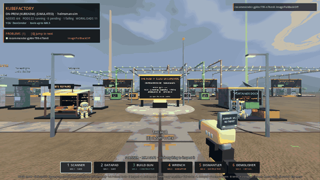
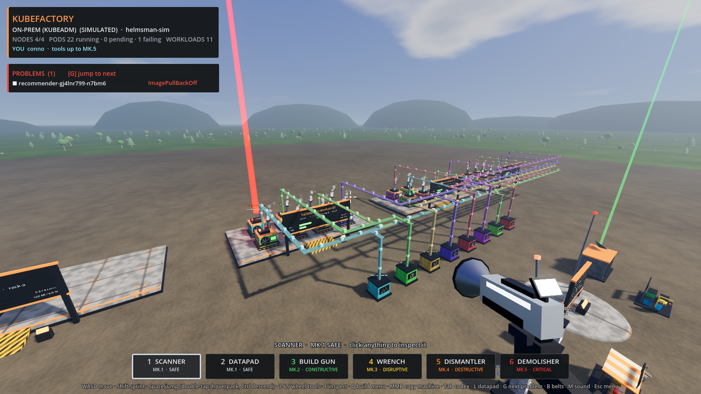
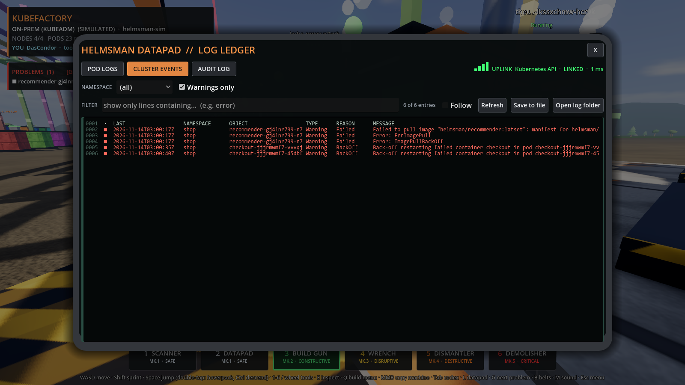
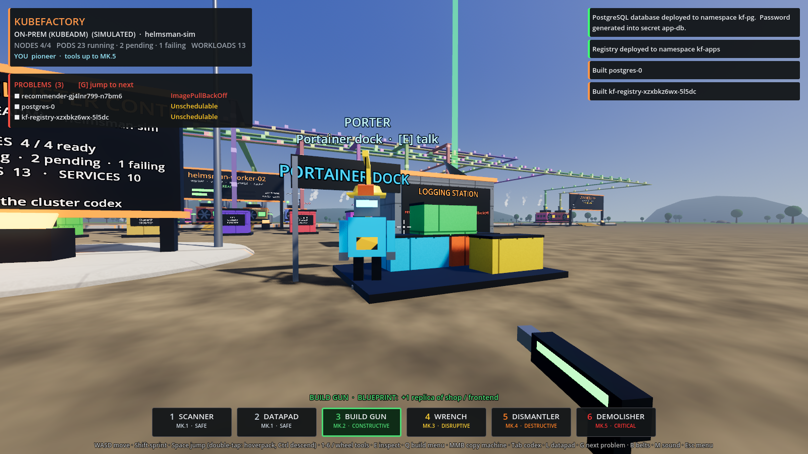

# KubeFactory

A first-person factory-builder game whose factory is your container cluster.
Walk around your Kubernetes clusters (or local Docker engine), see what is
broken from across the map, and operate it with a belt of tools.

Built with Godot 4.3. No art assets: everything is generated in code.

| | |
|---|---|
|  Nodes are platforms, pods are machines; red beams mark failing pods |  Tiered tools: stronger actions take a longer hold |
|  The datapad: pod logs, cluster events, audit trail |  Porter builds complete app setups and installs from app lists |
|  Other people on the cluster appear as avatars |  Mk.5 actions ask you to type the target's name |

## Play in the browser (sandbox demo)

**https://dascondor.github.io/kubefactory/**

The browser build is a sandbox: it runs the built-in simulated clusters only and
connects to nothing. A browser cannot run `kubectl` or Docker, so managing real
clusters needs the desktop build below. Every tool works against the simulation,
including Porter's bundled app setups; his online app lists do not load there.
Graphics are lighter than the desktop build (one shadow pass, fewer machine
details). Needs a desktop browser with keyboard and mouse; click the page to
capture the mouse. It is rebuilt and redeployed on every push to `main` by
`.github/workflows/pages.yml`.

## Download

Get the latest Windows build from
**https://github.com/DasCondor/kubefactory/releases/latest**
(`KubeFactory-<version>-win64.zip` plus its `.sha256` checksum). The executable
is not code-signed, so Windows SmartScreen asks for confirmation on first run.

## Install (release build)

Unzip `KubeFactory-<version>-win64.zip`, then:

    powershell -ExecutionPolicy Bypass -File install.ps1

That installs for the current user (no admin rights) to
`%LOCALAPPDATA%\Programs\KubeFactory` and adds Start Menu entries: KubeFactory,
KubeFactory (simulation) and KubeFactory (read-only). `-Quiet` skips the desktop
shortcut for IT rollouts. Upgrading keeps your edited config files.
`uninstall.ps1` removes it (`-Purge` also removes settings and audit logs).
You can also just run `KubeFactory.exe` from the unzipped folder.

Command-line options go after `--`:

    KubeFactory.exe -- --demo                   built-in simulated cluster (safe to break)
    KubeFactory.exe -- --sim=aws-eks-prod       or azure-aks-staging, gke-analytics, rancher-edge
    KubeFactory.exe -- --context=<name>         a specific kubeconfig context
    KubeFactory.exe -- --read-only              look, don't touch

With no options it connects to your current kube context, then Docker, then the
simulation. `KubeFactory.console.exe` is the same game with a console window,
for troubleshooting. `check-requirements.ps1` checks for kubectl and the
optional cloud CLIs.

The files next to the exe are yours to edit: `policy.json`, `catalogs.json`,
`log-providers.json`, `portainer.json` and the app setups in `apps\`.
Per-user settings, audit logs and saved logs live in
`%APPDATA%\Godotpp_userdata\KubeFactory`.

## Editions

The same game also comes in two narrower builds. They install side by side with
the full game (`KubeFactory Docker`, `KubeFactory Demo`).

| Edition | Opens on | Never touches |
| --- | --- | --- |
| **KubeFactory Docker** | your local Docker engine: every container is a machine, Compose projects are namespaces | kubectl / any Kubernetes cluster |
| **KubeFactory Demo** | the built-in simulated clusters, with every tool unlocked | kubectl and Docker: it connects to nothing |

The Docker edition falls back to the simulation while the Docker engine is not
running. Build them with `package.ps1 -Edition docker` / `-Edition demo`, or
run them from source with `play-docker.bat` / `play-demo.bat`.

## Run from source

    setup.ps1          checks / installs the software below (including the engine)
    play.bat           same options as above, without the leading --
    play-docker.bat    the Docker edition      play-demo.bat    the Demo edition
    package.ps1        runs the tests and builds the release zip + checksum in dist
                       (-Edition docker | demo builds that edition instead)
    dev-cluster.ps1            3-node Kubernetes cluster in Docker containers (kind),
                               with sample workloads, two of them broken on purpose
    dev-cluster.ps1 -Delete    remove it
    dev-users.ps1              multi-user setup + two test logins on that cluster

## Software

| Software | Needed for | Install |
|---|---|---|
| Godot 4.3 (portable, in `engine\`) | running the game | `setup.ps1` downloads it |
| kubectl | any real Kubernetes cluster | `winget install Kubernetes.kubectl` |
| Docker Desktop | local containers, dev cluster | `winget install Docker.DockerDesktop` |
| kind | dev cluster in Docker | `winget install Kubernetes.kind` |
| AWS CLI | EKS login, CloudWatch logs | `winget install Amazon.AWSCLI` |
| Azure CLI + kubelogin | AKS login, Azure Monitor logs | `winget install Microsoft.AzureCLI Microsoft.Azure.Kubelogin` |
| Google Cloud SDK + gke-gcloud-auth-plugin | GKE login, Cloud Logging | `winget install Google.CloudSDK` |
| curl (ships with Windows) | Grafana Loki logs | - |

Rancher needs nothing extra: download the cluster's kubeconfig from the Rancher UI.
`setup.ps1 -Cloud` installs the three cloud CLIs.

## What you see

| In the game | In the cluster |
|---|---|
| Foundation platform with a gantry sign | Node (status, CPU / memory requests, zone, instance type) |
| Machine | Pod (colour = workload; status screen, beacon, smoke when healthy) |
| Tanks on a machine | Containers |
| Red light column + warning sign | Failing pod (CrashLoopBackOff, ImagePullBackOff, Error ...) |
| "Unscheduled" platform | Pods no node can take |
| Depot + conveyor belts | Service and the pods it routes to |
| Cluster gates beside the HUB | kubeconfig contexts, Docker, simulations (provider-coloured) |
| Logging Station (dish + light column) | Log providers; column is green when linked, red on no signal |

## Tools (keys 1-6 or mouse wheel)

Stronger tools have a higher Mk, a hotter colour and a longer hold. The same
tier colours mark every button in the panels.

| Key | Tool | Tier | Does |
|---|---|---|---|
| 1 | Scanner | Mk.1 Safe | click to inspect a pod / node / service |
| 2 | Datapad | Mk.1 Safe | click a machine to read its log ledger |
| 3 | Build Gun | Mk.2 Constructive | Q for blueprints; click a foundation: +1 replica or a new deployment |
| 4 | Wrench | Mk.3 Disruptive | hold: rolling restart (machine), cordon / uncordon (node sign) |
| 5 | Dismantler | Mk.4 Destructive | hold: delete the pod |
| 6 | Demolisher | Mk.5 Critical | long hold: delete the whole workload, or drain the node |

Other keys: WASD, Shift sprint, Space jump (double-tap for hoverpack, Ctrl to
descend), E inspect, MMB copy a machine as blueprint, Tab cluster codex,
L datapad, G jump to next problem, B belts, F11 fullscreen, Esc menu.

## Teams (multi-user)

Several people can work on the same cluster at once, each with their own login.
They see each other as avatars, share an action feed, and are held to a tool-tier
policy the cluster admin sets. Limited accounts work: a namespace-only user sees
that namespace, and tools they have no permission for are locked. Mk.5 actions
require typing the target's name. See **ADMIN.md** for setup; `dev-users.ps1`
creates two test logins on the dev cluster so you can try it in three windows.
`package.ps1` builds a zip to hand out.

## Porter, the Portainer dock worker

Beside the HUB stands Porter, a crane-backed robot. Press E to talk. He can:

- **Build a complete app setup** from his dock: Web server, Redis, PostgreSQL,
  WordPress + MySQL. Each comes with its workloads, Services, storage and a
  generated password (Kubernetes Secret, or an env file for Compose). On
  Kubernetes they are applied from `apps/<id>.k8s.yaml`; on a Docker engine they
  run as a Compose project from `apps/<id>.compose.yaml`. Edit or add files there.
- **Order from app lists**: any list in Portainer's app-template format.
  `catalogs.json` ships with Portainer's official list and two community lists;
  add more by URL in the conversation (kept in the user folder). Container
  templates become a Deployment + Service on Kubernetes or a `docker run` on
  Docker. Stack templates are skipped.
- **Manage what he installed**: status, go to, logs, restart, remove.
- **Install Portainer itself** (optional) and open its console. Put your
  Portainer address and an API key in `portainer.json` and its own template
  list shows up as "My Portainer server".

## Sound

All sounds are synthesised at startup (tool switch, build, dismantle, charge-up
while holding, footsteps, datapad, a positional alarm on failing machines).
M mutes.

## Logs

The datapad (L) has three ledgers: pod logs, cluster events, and an audit trail
of everything done through the game. The audit trail and saved logs are written
to `%APPDATA%\Godot\app_userdata\KubeFactory\logs`.

Pod logs can come from several providers; pick one on the datapad. Configure
them in `log-providers.json`:

| Provider | Needs |
|---|---|
| Kubernetes API | nothing |
| Grafana Loki | `loki.url` (optionally `query`, `tenant`, `user`) |
| AWS CloudWatch | aws CLI; `cloudwatch.log_group` (guessed for EKS Container Insights) |
| Azure Monitor | az CLI; `azure.workspace_id` (ContainerLogV2) |
| Google Cloud Logging | gcloud CLI |

## Layout

    scripts/main.gd             game loop, tools, input
    scripts/world.gd            cluster state -> 3D world
    scripts/platform.gd         node platform        scripts/machine.gd   pod machine
    scripts/hud.gd              HUD, panels, datapad
    scripts/cluster.gd          polling, actions, audit log
    scripts/backend_kubectl.gd  real clusters        scripts/backend_docker.gd   Docker engine
    scripts/backend_demo.gd     simulated clusters   scripts/log_sources.gd      log providers
    scripts/apps.gd             Porter's setups, app lists, install ledger
    scripts/sfx.gd              synthesised sound    apps/                       bundled app setups
    tests/normalize_test.gd     parser test:  engine\Godot_v4.3-stable_win64_console.exe --headless --path . -s tests/normalize_test.gd

`play.bat --demo --shots=<folder>` runs an automated screenshot tour (dev aid).
Against a real context or Docker engine it also deploys and removes throwaway
`kf-*` apps, scales `shop/frontend`, deletes one of its pods and, on Docker,
installs Portainer. Only point it at a dev cluster.

## Security

KubeFactory has no server and stores no credentials: it runs your own `kubectl`
and `docker`, as you. Your cluster permissions are the security boundary; the
in-game tiers and confirmations are guard rails. App lists are treated as
untrusted input. See [SECURITY.md](SECURITY.md) for the details and for how to
report a problem.

## License

MIT, see [LICENSE](LICENSE). KubeFactory is built with the Godot Engine (MIT);
notices for it and for the third-party names used are in
[THIRDPARTY.md](THIRDPARTY.md). KubeFactory is an independent project and is
not affiliated with Kubernetes, Portainer, Docker or any cloud provider.
