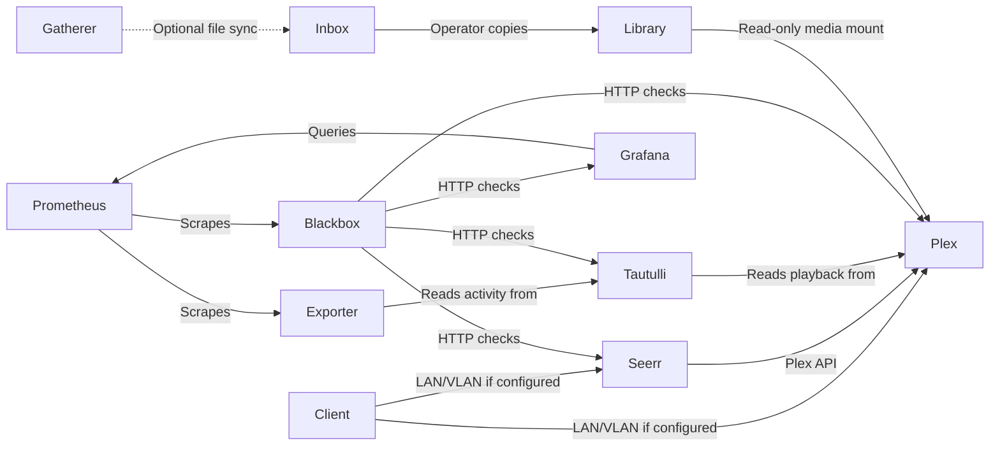
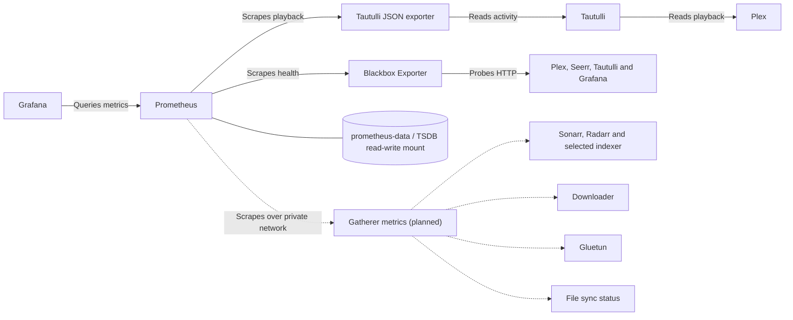

# KubeFactory 2.1 to 2.2 handoff

The baseline is `v2.0.0-beta.3`. This checkout adds the Docker media lab and the in-game port grouping described below. The block-building features are the 2.2 implementation scope.

The [feature and release gap matrix](FEATURE_PARITY.md#21-and-22-feature-matrix) tracks implementation, verification and acceptance across these versions.

## Play the Docker media lab

Open **Demo worlds** and pick **Docker media lab** for the seven-service starter or **Docker media lab + gatherer** for the full fifteen-service stack. From a local Godot checkout, launch with `-- --demo=docker-media` or `-- --demo=docker-media-gatherer`.

Set `host_count` in [media-lab.json](../media-lab.json) to `1` or `2`, then restart the game. Set `indexer` to `jackett` (default) or `prowlarr` to choose the gathering node's indexer, or switch it in game under **Docker media lab → Use Prowlarr instead**, which restarts the demo world. Prowlarr answers Sonarr's and Radarr's searches like Jackett, and also pushes its indexer list into them; both reach the internet only through Gluetun. The full stack defaults to one host, including Sonarr, Radarr, Jackett, the downloader, Gluetun, reporting and file sync. With two hosts, gathering services move to the separate gathering node. The host count is controlled by the config file. In a desktop package the editable file sits beside the executable. Browser exports bundle the project config, so editing it requires rebuilding the web demo.

1. Open the hub or choose **Docker media lab** from the pause menu. Select **View the factory** to see both ends of the network. Use **Trace connections** to pick an exact route or filter by connection type.
2. Switch Plex and Seerr from Loopback to LAN or VLAN 30. In **Ports and readiness**, pick a client network to see the simulated result. The single-host full stack uses its private Docker bridge for API calls, scrapes and sync. The two-host layout uses the designated management VLAN 40 between hosts.
3. Inspect the **prometheus-data**, library, inbox, and outbox cabinets. The disk panel lists each container’s mount and capacity once per backing volume. Only usage over the configured threshold appears in the main HUD. The default is 87 percent. The sample library starts at 90 percent to demonstrate the warning.
4. In the full stack, use **Visit the sync lever**. Aim at the handle and press E or tap the action control to pause and resume. With a file in the inbox, use **Import one file** and inspect the Plex library. The controls follow the normal session and tool-tier permissions in both host layouts.
5. Send a simulated Seerr alert or disable the Discord route. The demo uses sample files and simulates requests, probes, VPN traffic and notifications locally.

The playable gatherer uses Jackett or Prowlarr. The optional [Compose lab](../examples/docker-media/README.md) is a separate setup for testing with a real Docker engine.

## 2.1 review

| Area | Review from 2.1 |
| --- | --- |
| Single-node Docker | Bring up Plex, Seerr, Tautulli, Blackbox Exporter, Prometheus, and Grafana with the [Docker media lab](../examples/docker-media/README.md). Select the local Docker context in KubeFactory. Confirm one node, a machine per container, the Plex library mount, and logs for Seerr. |
| Exposed ports | The Ports and Readiness view groups host-facing, loopback, and internal ports. Docker rows retain the actual bound IP, published port and target protocol, including configured bindings on stopped containers. An operator label identifies an intended VLAN. Verify LAN and VLAN reachability from clients on those networks. |
| Reporting and storage | Play a file from the local library. With the playback overlay, trace Plex to Tautulli to Prometheus and Grafana. Stop Seerr to see the difference between container state and an actual HTTP probe failure. With the gathering overlay, trace a file into the inbox and follow the manual import into the Plex library. |
| Existing simulation | Keep the k3s Media Suite, the animated network and VPN paths, shared disk and port inspection, simulated app dashboards, mobile navigation, and the local flow planner working across the handoff. Keep the Docker example distinct in the desktop connection picker. |

## Required 2.2 scope

- Voxel-style workload blocks, grid placement and undo, connectable sockets, and a shared factory and flowchart layout with migration and Compose preview.
- A guided single-node Docker media preset and a supported two-node option with Sonarr/Radarr, a selectable Jackett or Prowlarr indexer, a downloader, and Gluetun. Show private requests, file sync and metrics as three traceable paths between hosts.
- Show every container and defined connection in the default in-game overview, including LAN/VLAN ingress, private routes, outbound HTTPS and VPN, and optional Seerr Discord alerts. Show the exact bindings and the source and result of selected reachability checks.
- Direct reporting connections for Plex, Tautulli, the playback exporter, Prometheus and Grafana, plus HTTP health through Blackbox and private gatherer metrics. Show the shared metrics data source and its backing data container.
- Shared capacity and mounts, the gatherer outbox, media inbox and read-only Plex library, reporting volumes, transfer activity, and permission-checked in-world sync switches. Surface a main HUD storage warning only above the configured threshold, which defaults to 87% used.
- Desktop and phone checks, both Compose demo paths, and a reproducible walkthrough with updated concept and release visuals.

## 2.2 block builder

### Place and recognize workloads

Add a voxel-style build mode to the simulation. Use a snap grid with visible placement and rotation previews. Start with six shapes that work without color, with a neutral cube for unrecognized apps.

| Block | Shape and use |
| --- | --- |
| App | Glass front and service label for dashboards, media players and web apps. |
| Worker | Vented cube for workers, importers and gatherers. |
| Storage | Stacked-drive face with read and write sockets. |
| Gateway | Two differently shaped faces for ingress and egress, with arrows for direction. |
| Reporting | Gauge face for exporters, collectors and dashboard services. |
| Generic | Plain cube with the workload name and status. |

Use the block appearance as a visual choice. A Kubernetes pod can contain several containers, and a Docker container remains a container. Pick a default appearance from the service role and allow an override stored in the local layout. Preserve existing object identifiers, inspection, and dashboard access. Placing, rotating, and deleting a block should work with pointer, keyboard, and tap controls.

### Connect blocks and save the plan

Open a small socket picker from a block. Select a source and destination, preview the route, and confirm. Give application traffic, VPN egress, volume mounts, and file handoffs distinct sockets and arrow treatments. Preserve compatible type and direction, show the protocol and target port, and keep every visible route linked to its two endpoint IDs. Highlight the selected route and show its names on demand. Route pipes through aisle space with elbows and common fittings.

Extend the existing flowchart in `scripts/flow_planner.gd` so the graph and the factory load and save the same layout. Persist a schema version, block IDs, optional observed workload IDs, integer grid coordinates, rotation, chosen appearance, and named sockets. An edge stores the source and destination socket IDs and its connection type. Migrate existing saved node positions and edges with defaults. Reject incompatible socket types, duplicate edges, and unknown endpoints before writing a plan. Removing a block removes its edges in the same undoable edit. Browsers save the simulation locally and can import or export a plan.

The planner’s links describe intended traffic and mounts. Keep Docker or Kubernetes facts, declared routes, and measurements labeled separately in the inspector. Start with plan export and a reviewable Compose preview on desktop. Require a preview and explicit operator approval before any future application to a live engine. Kubernetes policy and VLAN enforcement depend on the real network configuration.

### Connect the Docker media preset

Start with one Docker node. The player places Plex, Seerr, Tautulli, an exporter, Prometheus, Grafana, and the library storage block. The optional gathering station occupies a second node. Show the corresponding service and mount IDs from the Compose files.

The preset’s guided steps follow the [lab walkthrough](../examples/docker-media/README.md). The browser can use the same topology with simulated probes, playback and file movement. Animate the file transfer on the gathering connection and the library import separately. Keep Plex and Seerr reachable only through their depicted published bindings and put reporting endpoints under host-only or internal scopes according to the Compose config.

#### In-game connection inventory

[View the consolidated Media Lab concept graphic](concepts/kubefactory-2.2-docker-media-sync-controls.png).

Default to **All connections** when the player opens the demo or its in-game network view. Show every container on the selected hosts, including the sync receiver and exporters, even when a container has zero connections. Show enabled external services as external endpoints. Every pipe corresponds to a configured, observed, or simulated edge with a named caller or writer, a target or receiving mount, and a scope. Unknown live app-to-app traffic stays marked unknown. Keep color-coded lanes at different heights and offer an endpoint trace and a readable connection list when pipes overlap. Filters narrow the current view on demand.

| Connection type | Direct endpoints in the media preset |
| --- | --- |
| Client LAN or media VLAN | Client inlet to Plex and Seerr when those host bindings are enabled. Host-only dashboards and internal exporters keep their own scopes. |
| Private application calls | Seerr to Plex and to Sonarr/Radarr; Sonarr/Radarr to the chosen indexer and the downloader. |
| Playback reporting | Grafana to Prometheus; Prometheus to the JSON exporter; exporter to Tautulli; Tautulli to Plex. |
| Health reporting | Prometheus to Blackbox; Blackbox to the configured HTTP endpoints. Prometheus to the optional gatherer metrics endpoint; the collector to the gathering services it can observe. |
| Volumes and file movement | Prometheus to its TSDB volume; Tautulli and Grafana to their own state volumes. Downloader and Syncthing mount the shared outbox. Syncthing sends to the media-sync receiver, which writes to the inbox. An import copies into the library, which Plex mounts read-only. |
| Internet egress | Plex and Seerr to their configured sign-in and metadata endpoints. Gathering apps to Gluetun, then from Gluetun to the WWW outlet. |
| Discord notification | Seerr (the Overseerr successor) to the configured Discord webhook over HTTPS when enabled. |

For Discord, show the Seerr source, destination label, selected notification types, and the last known delivery time and result. Keep the webhook URL and channel credentials out of labels, logs and screenshots. The browser demo shows simulated notifications. A live notification test requires the operator to initiate it. [Seerr Discord integration](https://docs.seerr.dev/using-seerr/notifications/discord/)

#### Optional VPN gathering node

The 2.1 sync overlay transfers operator-supplied files. The playable 2.2 simulation has Sonarr, Radarr, Jackett, qBittorrent, Syncthing and a Gluetun gateway on the gathering node. The indexer is selectable: Jackett or Prowlarr.

[View the LAN/VLAN and WWW routing concept graphic](concepts/kubefactory-2.2-docker-media-network.png).

| Route | What the player should see |
| --- | --- |
| LAN and VLAN ingress | Local clients enter from the LAN/VLAN side. Plex `32400/tcp` and Seerr `5055/tcp` are the opt-in media bindings. Both default to loopback in the Compose lab. |
| Host-only and private access | Tautulli `8181/tcp`, Grafana `3000/tcp` and Prometheus `9090/tcp` bind to loopback. Exporters, indexer and downloader endpoints stay on private paths in the proposed layout. |
| Private app calls | Seerr sends requests to Sonarr or Radarr. The selected app talks to the indexer and downloader through private endpoints. |
| Media HTTPS egress | Plex and Seerr use a separate outgoing path for Plex sign-in and metadata services. Tautulli’s playback connection is local. Its optional Plex OAuth login needs an external path when enabled. |
| Gathering VPN egress | Searchers, the selected indexer, and the downloader share the gateway. Their routes enter the factory side and a single pipe leaves for the WWW outlet. In the simulation, taking the gateway offline stops those external flows. |
| File transfer | The downloader writes to the gathering outbox. The sync link carries files to the media host inbox. The operator reviews and imports them into the separate library that Plex mounts read-only. |

The lab shows inbound listeners and outbound dependencies separately. The WWW outlet represents connections initiated by the apps. Router exposure and actual egress restrictions depend on the operator’s network configuration. [Plex network requirements](https://support.plex.tv/articles/200484903-internet-and-network-requirements/) · [Seerr Plex integration](https://docs.seerr.dev/using-seerr/plex/) · [Seerr metadata services](https://docs.seerr.dev/blog/seerr-release/) · [Tautulli Plex OAuth](https://github.com/Tautulli/Tautulli/releases/tag/v2.19.0)

#### Reporting connections

[View the direct reporting connections and data volume graphic](concepts/kubefactory-2.2-docker-media-reporting-data.png).

Give the Ports and Network view a Reporting filter with one pipe per configured caller and target. Show who initiates the request. Tautulli reads Plex playback. The JSON exporter reads Tautulli's activity endpoint and converts the response to Prometheus metrics. Prometheus scrapes the exporter. Grafana queries Prometheus directly.

Show **Prometheus** as the shared metrics data source. Its disk-shaped data container represents the `prometheus-data` volume mounted at `/prometheus`. Prometheus owns that read/write mount. Grafana reads shared metrics through the Prometheus query API. Tautulli keeps playback history in its own volume, and Grafana keeps its application state in its own volume. Style the disk mount separately from network calls. [Prometheus storage](https://prometheus.io/docs/prometheus/latest/storage/) · [Grafana Prometheus data source](https://grafana.com/docs/grafana/latest/datasources/prometheus/)

The current Compose lab includes the HTTP probes and an optional playback exporter. The proposed gathering node adds a private metrics endpoint for available app health, tunnel state and sync status. Prometheus would scrape it over the management LAN or VLAN. Show the source and age of each reading, and display unknown status when a signal is unavailable. The reporting connection stays separate from file sync and VPN egress.

#### Storage paths and mounts

Show shared backing storage once per host and list each container’s mount path and access on that storage card. Display used, free and total space with measurement time where the source reports them. Label whole-filesystem figures by filesystem and deduplicate repeated mounts. Show unknown capacity when the backend cannot measure it. Place the orange file motion at floor level so the player can follow it while the reporting pipes are visible.

Keep full disk figures in Storage, pod screens and dashboards. Outside those views, surface one main HUD warning per backing volume only when measured usage is strictly above the configured threshold, which defaults to 87% used. Display the affected volume, used percentage and free space when available. Clear the warning when usage returns to the threshold or below.

| Storage | Connection to show |
| --- | --- |
| Gatherer outbox | The planned downloader writes to the same outbox that Syncthing sends. The current gatherer Compose mounts `./outbox` at `/var/syncthing/outbox`. |
| Media host inbox | The receiver writes to `./incoming` through `/var/syncthing/incoming`. Show the cross-host sync arriving here. |
| Plex library | The operator copies approved files from the inbox into `./library`. Plex mounts it at `/media` read-only. |
| Reporting data | Tautulli history lives in `tautulli-config`, Prometheus samples in `prometheus-data`, and Grafana state in `grafana-data`. Give each named volume its own card. Grafana queries Prometheus over the reporting network. |

Show file sync and library import as separate activity rows. Label the trigger as change-driven, scheduled when configured, or manual. Give both rows a last-completed time, completed files and bytes over a selected window, and the current transfer or queue state when available. Count completed events once across replicas and show unknown when the event source does not report a value. The demo labels sample capacity and activity as simulated. Syncthing uses file-change notifications and periodic scans to detect changes. The scan interval and observed transfer frequency are distinct values. [Syncthing change detection](https://docs.syncthing.net/users/syncing.html#scanning)

#### In-world sync controls

Put a physical lever or switch beside each controllable sync pipe. Inspecting it shows the folder, source and destination, current activity and latest successful transfer. Show **Pause sync** when enabled and **Resume sync** when paused. Support the existing in-world interact action and touch controls.

Allow activation for operators with permission to control that folder. Viewers can inspect its state. Enforce access at the backend or KubeFactory server and use the existing action guard rails and audit log. In live mode, bind the lever to one configured Syncthing folder and change only its paused state. Update the display from confirmed backend state. Show permission, unavailability or errors on the lever when applicable. The browser demo simulates the same actions. Library import remains a separate operator action. [Syncthing configuration endpoints](https://docs.syncthing.net/rest/config)

#### Internal LAN and VLAN paths

Draw the client LAN or media VLAN as the opt-in entrance to Plex and Seerr. Show the local Docker app and reporting networks on the media host. Keep the host-only interfaces visibly scoped to loopback.

On a two-host setup, the media host and gathering node can communicate over a management LAN or VLAN. Draw three logical pipes between them with separate endpoints.

| Private pipe | Endpoints |
| --- | --- |
| Requests | Seerr → Sonarr or Radarr on the gathering node |
| Metrics | Gatherer metrics → Prometheus |
| File sync | Gathering outbox → media host inbox through the sync services |

Those flows can share a physical network link. On each host, branch the client entrance only to its configured published services. In the current demo, the receiver's sync listener defaults to loopback and must be bound to a reachable host address for cross-host sync. The planned metrics collector would use a private management endpoint. VLAN IDs shown in the demo describe the chosen network. Confirm the route and access rules from clients on each intended segment.

### Extend the in-game port view

Start with the 2.1 grouped list. Add scope filters for external/host, loopback, and internal, plus host/segment filters for multi-node worlds. Show the bind address, target, protocol, declared VLAN, and last check time. One host port can have several bindings. An IPv4 wildcard and an IPv6 wildcard each remain visible. For Docker host networking and macvlan or ipvlan addresses, report what the engine knows and put unknown listener information alongside it.

Offer **Check from here** on one selected binding when a desktop operator asks. Mark the origin, timestamp, and outcome, such as TCP connected, timed out, refused, or no check. Keep HTTP result separate from TCP connectivity. A UDP port with no response remains unknown. For a LAN or VLAN claim, prompt the operator to run the same check from a client on that network.

## Ready for 2.2 review

- Place, rotate, connect, save, reload, and undo in the media preset. Verify blocked placement, matched socket types, and stable graph-to-world links.
- Reopen a saved 2.1 flowchart. Compare the resulting layout and links with the original.
- Verify the preset on a desktop and in a narrow phone browser in both orientations. Confirm that opening a dashboard or port panel returns focus to the selected block.
- Compare the Docker port list with `docker inspect` for loopback, wildcard, dual-stack, stopped containers, and internal-only ports. On a real LAN/VLAN, check from allowed and disallowed clients and confirm that the game identifies the source of each result.
- Open the default view and trace every declared demo edge to both endpoints. Confirm idle containers remain visible. Enable simulated Discord alerts and verify the Seerr route, event and delivery outcome with credentials absent from the display.
- Trace each direct reporting call. Verify Grafana reads through Prometheus and that the Prometheus data cabinet identifies the single `prometheus-data` mount.
- Bring up the Compose variants, play a clip, observe reporting and a stopped service, and transfer a small file from a second engine. Verify the latest sync time and recent count change once, then manually import and confirm a separate import event. Check used and free space against the reporting source and confirm shared mounts do not duplicate capacity.
- Check the main HUD at 86%, 87%, and 88% with the default storage threshold. Verify usage remains available in the disk view throughout, then change the threshold and verify the warning updates.
- Inspect a sync switch as a viewer, then pause and resume the folder as an authorized operator. Verify the transfer state and history, and confirm that unrelated folders keep syncing.
