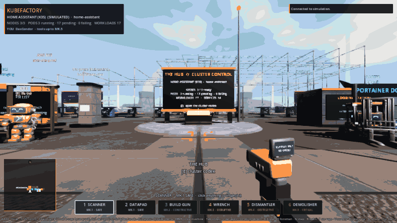
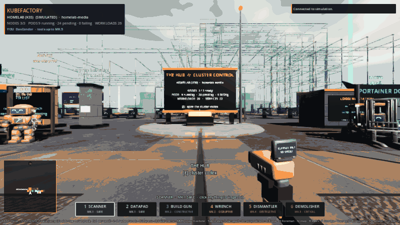

# Connection whiteboard

The whiteboard draws every app, volume and outside endpoint of a demo world as
a diagram, with every route between them. Open it from the game menu
(**Connection whiteboard**, or **Whiteboard** on phones) or from **Network and
shared data**. Demo data is SIMULATED.

The tour visits every demo world's whiteboard: Kubernetes cluster, Home
Assistant, Dev containers, Media suite, Docker media lab, and the Docker media
lab with its gatherer. [Watch it as an MP4](media/board-tour.mp4).

## Views

| View | What it shows |
| --- | --- |
| **Isometric** (default) | Grid paper with a rounded tile per endpoint, its app icon and name, and lines along the grid with arrowheads. A dot moves along a route while it carries traffic. |
| **2D** | The same board from straight above, with the same layout and selection. |
| **Cards** | The card board, with each endpoint's ports listed on its card. |

Select a tile to lift it and fade everything unrelated. Each of its routes gets
a callout saying what it carries: HTTPS, Metrics, Storage mount, LAN · down.
Double-click or double-tap a tile to open its config and storage files.

## Each demo world

One short tour per world: its board, its busiest tile with callouts, a closer
look, then the same board in 2D.

### Kubernetes cluster

[Watch as MP4](media/board-kubernetes.mp4)

### Home Assistant

[Watch as MP4](media/board-home-assistant.mp4)

### Dev containers

[Watch as MP4](media/board-dev-containers.mp4)

### Media suite

[Watch as MP4](media/board-media.mp4)

### Docker media lab

[Watch as MP4](media/board-docker-media.mp4)

### Docker media lab + gatherer

[Watch as MP4](media/board-docker-media-gatherer.mp4)

## Controls

| | Mouse | Touch |
| --- | --- | --- |
| Pan | drag the paper | drag the paper |
| Zoom | wheel, or **+** / **-** | pinch |
| Select | click | tap |
| Open files | double-click | double-tap |
| Move a tile | drag it | select it, then drag it |

**Fit board** shows the whole board. On a phone it stops at a readable tile
size and you drag to see the rest. **Save whiteboard** keeps your layout on
this device, and the board table in the factory uses it too.

## Re-recording this page's media

`powershell -ExecutionPolicy Bypass -File tools\record-tour.ps1 board` records
the all-worlds tour again (`media/board-tour.mp4` and `.gif`). Use `boards`
instead of `board` to record each world's own tour
(`media/board-<world>.mp4` and `.gif`).
