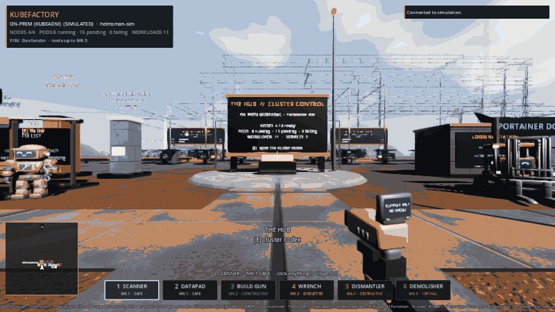
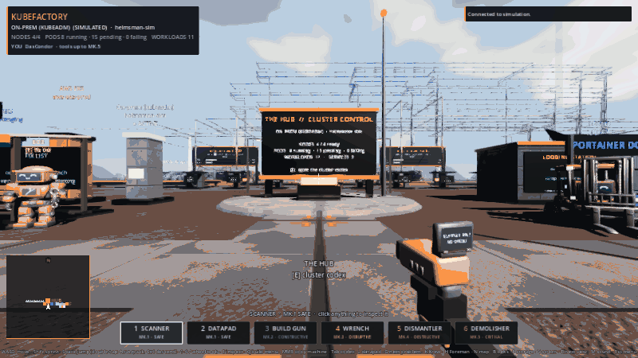
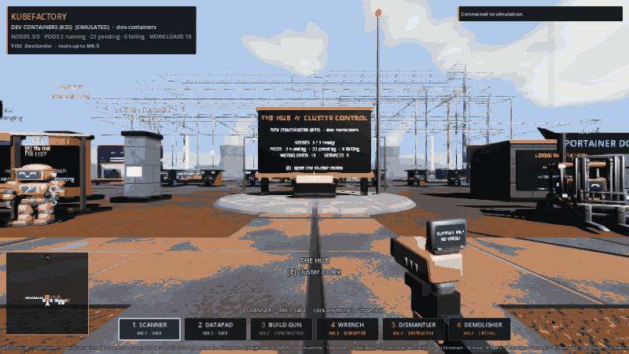
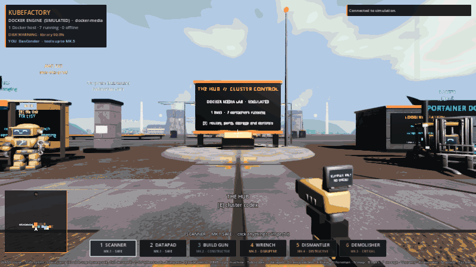
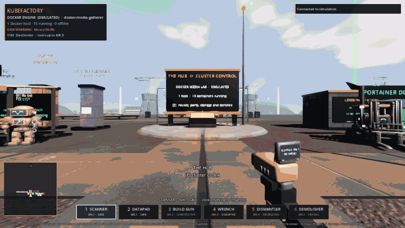

# Connection whiteboard

The whiteboard draws every container in a demo world, and in the Docker media labs every volume and outside destination, as a diagram with every declared connection between them. It is available in all demo worlds: the Kubernetes cluster, Home Assistant, Dev containers, the Media suite and both Docker media labs.

Open it from **Esc → Connection whiteboard** (**Whiteboard** in the phone menu), or from **Network and shared data → Visual whiteboard**. In the Docker media lab it is also in the **Docker media lab** menu, and a board table stands in the factory.

[Watch the tour of every world (MP4)](media/board-tour.mp4)

## Three views

Pick one with **View** in the toolbar. Isometric and 2D share one layout and one selection.

| View | What it shows |
| --- | --- |
| **Isometric** (default) | Grid paper with a rounded pastel tile per endpoint, its app icon, name and listener (for example `5055/tcp`). Connections run along the grid with one right-angle turn and an arrowhead at the target. A dot moves along a route while it carries traffic. |
| **2D** | The same board seen from straight above. |
| **Cards** | The card board: each container a card with its listener and the kinds of connection it takes part in, inputs on the left and outputs on the right. |

Select a tile to lift it and fade everything unrelated. Each of its connections gets a **callout** saying what it carries: **HTTPS**, **Metrics**, **Storage mount**, **LAN · down** and so on. Line colours follow the legend under the toolbar: **LAN**, **API**, **Metrics**, **Files**, **Storage mounts**, **HTTPS**, **VPN** and **Alerts**. A route whose target is down is drawn faded.

Everything on the board is **SIMULATED**: the demo's declared routes, not measured traffic. A live cluster or Docker engine reports no application-to-application traffic, so the whiteboard is a demo view.

## Using it

| | Mouse | Touch |
| --- | --- | --- |
| Pan | drag the paper (or right-drag) | drag the paper |
| Zoom | wheel, or **+** / **-** | pinch |
| Select | click a tile | tap a tile |
| Open its files | double-click | double-tap |
| Move a tile | drag it | select it, then drag it |

| Toolbar | What it does |
| --- | --- |
| **All / Reporting / Storage / LAN / VLAN / Internet / VPN** | Narrows the board to one group of connections. |
| **Fit board** | Shows the whole board. On a phone it stops at a readable tile size; drag to see the rest. |
| **Spider layout** | Lays the board out again around a hub (Prometheus where there is one). |
| **View** | Isometric, 2D or Cards. |
| **Find app / storage…** | Jumps to a tile. |
| **Trace selected** | Closes the board and highlights that tile's routes in the factory. |
| **Inspect selected** | Opens the tile's ports and readiness, or the shared disk for a volume. |
| **Config / storage files** | Opens the container's mounted files in the [text editor](https://github.com/DasCondor/kubefactory/wiki/Text-Editor). Saving asks first and keeps a backup. |
| **Show every route** | Shows all routes on the board and all pipes in the factory. |
| **Edit / export YAML** | Opens the map as Compose or Kubernetes YAML. Exporting asks for approval and changes nothing in a cluster. |
| **Save whiteboard** | Keeps the layout on this device; the board table in the factory uses it too. Each demo world keeps its own layout. |

On a phone the less used buttons sit under **More…**, so the board gets the screen.

## Each demo world

**Kubernetes cluster:** the shop's frontend, cart, checkout, catalog database and Redis, with Prometheus scraping the node exporters.

 · [MP4](media/board-kubernetes.mp4)

**Home Assistant:** the hub calls MQTT, Z-Wave, Matter, Frigate, Music Assistant, the Wyoming voice services and the recorder database. Zigbee2MQTT and Frigate publish to Mosquitto, and Grafana reads InfluxDB.

 · [MP4](media/board-home-assistant.mp4)

**Dev containers:** Gitea and Woodpecker CI, the agents' BuildKit builds pushed to the registry, the sccache compiler cache, MinIO artifacts, and every dev container pushing to Gitea.

 · [MP4](media/board-dev-containers.mp4)

**Media suite:** requests, index searches, download queues, file imports and Prometheus scrapes. Its VPN routes are drawn in the factory and listed in [VPN tunnels](VPN-Gateways.md) rather than on the board: each per-app Gluetun runs inside its pod, so it has no tile of its own.

 · [MP4](media/board-media.mp4)

**Docker media lab:** Plex, Seerr and reporting on Docker, with volumes (`plex-config`, `prometheus-data`, `inbox`, `library`, …) and outside destinations (**WWW OUT**, **LAN / VLAN IN**, Discord) as tiles. Replicas each get their own tile.

 · [MP4](media/board-docker-media.mp4)

**Docker media lab + gatherer:** the lab with its gathering node, VPN and file sync. See [Docker media lab](https://github.com/DasCondor/kubefactory/wiki/Docker-Media-Lab).

 · [MP4](media/board-docker-media-gatherer.mp4)

The videos are recorded with `tools\record-tour.ps1 board` (every world) and `tools\record-tour.ps1 boards` (one per world), and re-recorded with every major change to the board.

Related: [Docker media lab](https://github.com/DasCondor/kubefactory/wiki/Docker-Media-Lab) · [Block builder](https://github.com/DasCondor/kubefactory/wiki/Block-Builder) · [Ports and shared disks](Ports-and-Shared-Disks.md)
