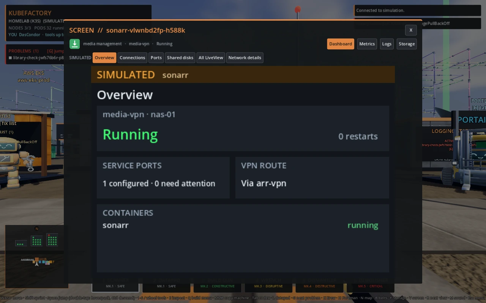
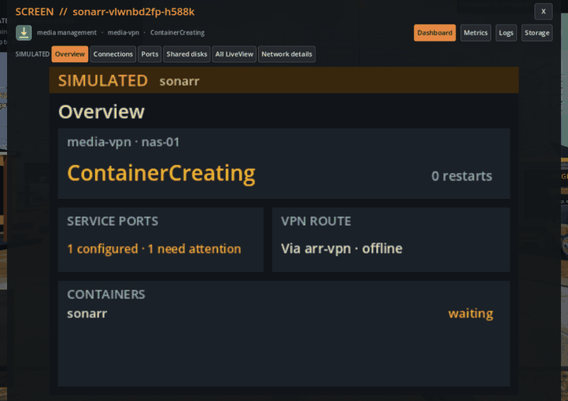

# Media demo

Open **Demo worlds → Media suite** from the pause menu, or launch the desktop demo with `--demo=media`. The lab contains a Plex stack, a Jellyfin stack, and monitoring. Each app has a simulated screen. Aim at a machine and press **V**, or open it from the LiveView dashboard directory.

## Follow one app through the factory

1. Open Sonarr in the `media-vpn` namespace. **Overview** shows its status, service port count, containers, and VPN route.
2. Open **Ports** and check `8989/TCP`. Then open **Network and Shared Data → Ports and readiness** for the cluster view. The deliberate `library-check` image failure leaves its `9101/TCP` service with zero ready pods.
3. Switch to **Shared disks** and choose **Mount details**. Deluge writes to `/downloads`, Sonarr and Radarr read from it, and either importer can write to `/media`. Jellyfin reads `/media`.
4. In **VPN tunnels**, select `arr-vpn` to follow the shared route used by Sonarr, Radarr, and Prowlarr, or select Deluge to compare its dedicated tunnel.

[Watch the dashboard and storage walkthrough (MP4)](media/dashboard-tour.mp4)

## More to inspect

- **Heimdall** opens the app directory and links recent failures to Bob's diagnosis. **Image Updater** lets you review a simulated fix for `library-check`.
- **Tautulli** shows simulated playback activity. In **Network and Shared Data**, follow Tautulli's API calls to Plex and Prometheus's scrape of the Tautulli exporter. Grafana reads from Prometheus.
- **Files** isolates the simulated import pipes. The source and destination volumes have separate used and free space totals.

[VPN gateways](VPN-Gateways.md) · [Ports and shared disks](Ports-and-Shared-Disks.md) · [Mobile demo](Mobile-Demo.md)
