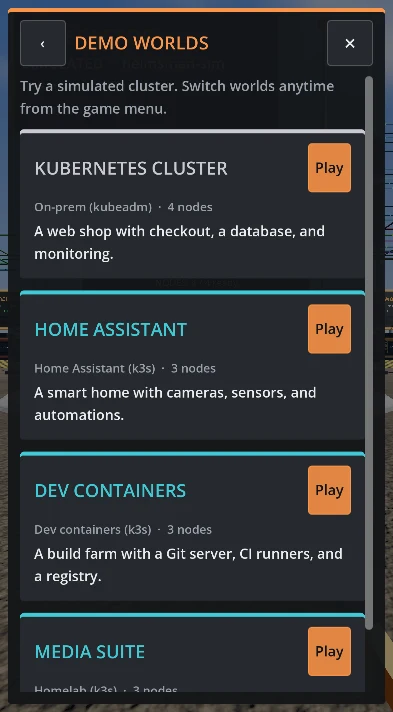

# Mobile demo

Open the [browser demo](https://dascondor.github.io/kubefactory/) on a phone. Use the on-screen stick to move, drag the view to look around, and tap **Menu** for demo worlds and settings. On a hybrid device, `?touch=1` forces touch controls for the demo.

The tall phone view presents wide dialogs sideways so their text stays legible. Turn the phone to landscape to read the same dialog upright. Menus and dashboards refit when the viewport changes, and a held touch is canceled on rotation. After turning, lift your finger before tapping again.

| Portrait | Landscape |
| --- | --- |
|  |  |

The walkthrough was checked in emulated phone orientations. Device-specific browser and touch behavior may vary.

[Media demo](Media-Demo.md) · [VPN gateways](VPN-Gateways.md)
