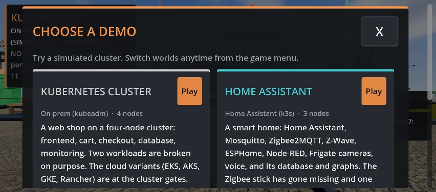

# Mobile demo

Open the [browser demo](https://dascondor.github.io/kubefactory/) on a phone. Use the on-screen stick to move, drag the view to look around, and tap **Menu** for demo worlds and settings. On a hybrid device, `?touch=1` forces touch controls for the demo.

Menus and dashboards stay upright in portrait and landscape. The title and **Close** button stay visible while you scroll. **Back** returns to the menu that opened the page. Some wide tables also scroll horizontally.

Use **Dashboards** to find a pod by name. **Network** opens the port, shared disk, and VPN views. **Settings** includes touch look speed, field of view, graphics, and sound.

| Portrait | Landscape |
| --- | --- |
|  |  |

The walkthrough was checked in emulated phone orientations. Device-specific browser and touch behavior may vary.

[Media demo](Media-Demo.md) · [VPN gateways](VPN-Gateways.md)
