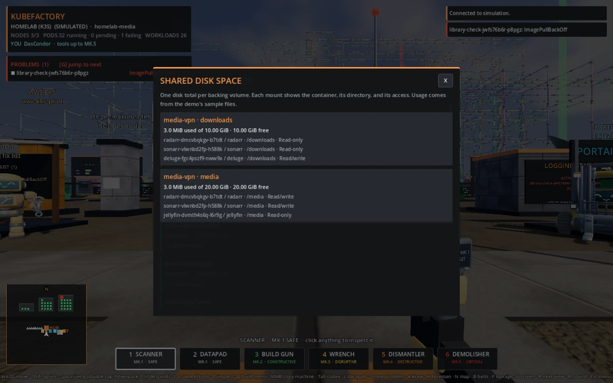
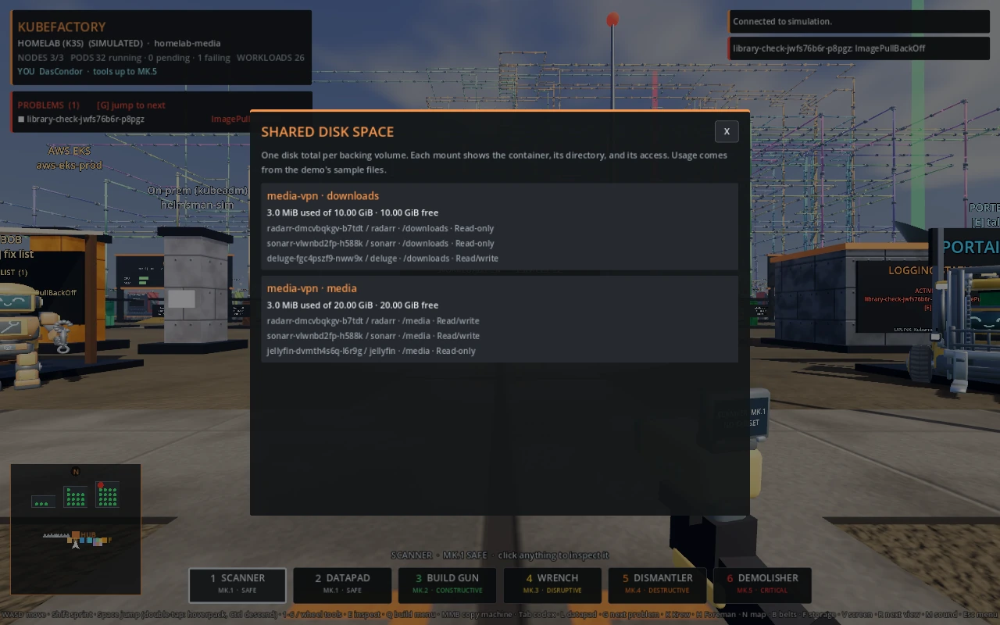

# Ports and shared disks

Open **Network and Shared Data** for the whole cluster. From a machine dashboard, choose **Ports** or **Shared disks** to see the entries for that pod.

## Ports and readiness

**Ports and readiness** shows the configured port and protocol, exposure, and available backend readiness. For a mapped NodePort, the node port appears beside the Service port. Docker host mappings are labeled separately from container-only ports.

Rows with no ready backends appear first. A running pod or configured host binding can still be unreachable. Verify live connectivity from the network that needs access. The media demo shows `library-check` on `9101/TCP` with `0/1 pods ready` while the sample image pull fails.

## Shared disk space

**Shared disk space** groups mounts by their backing volume. Each card shows one used/free total and the participating containers, mount paths, and read-only or read/write access. Matching directory names can point to separate disks. For example, `media` and `media-vpn` each have their own downloads claim.

| In `media-vpn` | Writers | Readers |
| --- | --- | --- |
| `/downloads` | Deluge | Sonarr, Radarr |
| `/media` | Sonarr, Radarr | Jellyfin |

Demo usage comes from sample files. For live mounts, membership uses reported PVCs, Docker volumes, or host paths, and missing usage data is shown as unreported.

[Media demo walkthrough](Media-Demo.md)
