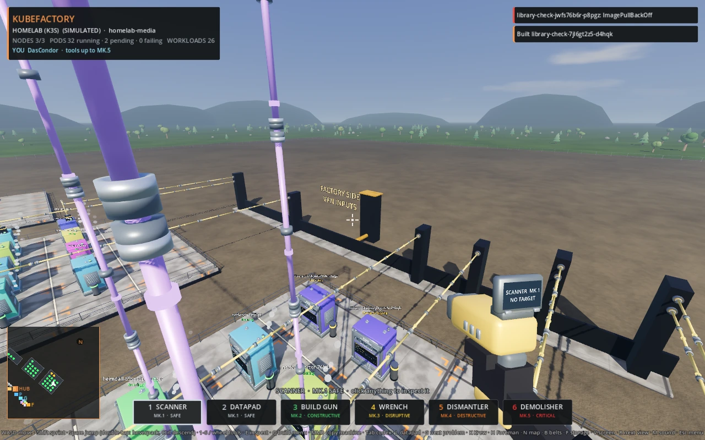

# KubeFactory visual guide

KubeFactory turns Kubernetes pods and Docker containers into machines you can inspect in a first-person factory. The browser demo uses simulated clusters. The screenshots and recordings below come from the media demo in this build.

| Start here | What you can follow |
| --- | --- |
| [Media demo](Media-Demo.md) | Plex and Jellyfin, app dashboards, failed ports, downloads, and libraries |
| [VPN gateways](VPN-Gateways.md) | One VPN per app or a shared gateway, from the first pipe to the WWW outlet |
| [Ports and shared disks](Ports-and-Shared-Disks.md) | Configured ports, backend readiness, and every container on a shared volume |
| [Mobile demo](Mobile-Demo.md) | Touch controls and switching between portrait and landscape |

For installation and live connections, see [Getting started](https://github.com/DasCondor/kubefactory/wiki/Getting-Started) and [Connections](https://github.com/DasCondor/kubefactory/wiki/Connections). The [documentation index](https://github.com/DasCondor/kubefactory/wiki/Documentation-Index) covers the full project. See the [changelog](../CHANGELOG.md) and [known limitations](../KNOWN_LIMITATIONS.md) for release and verification status.
