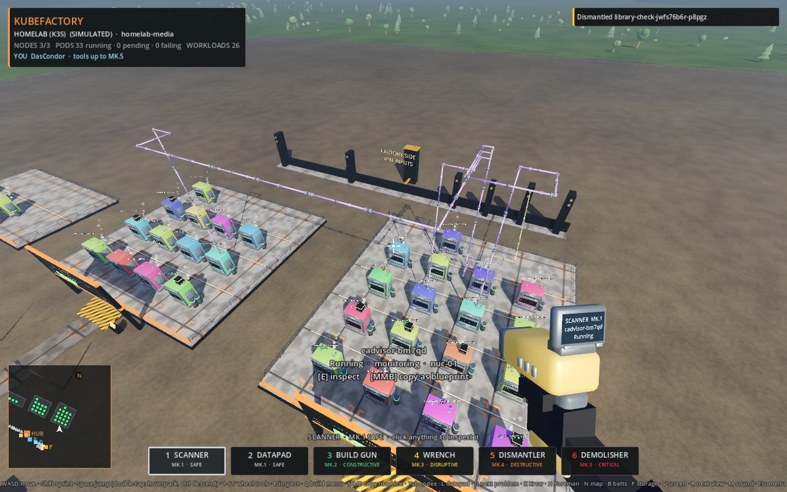
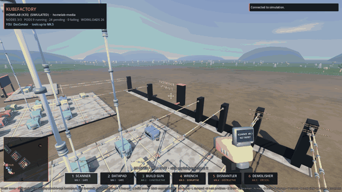

# VPN gateways

**Esc → VPN tunnels** lists the detected gateways, the apps they carry, and the exit address when reported. Select one or more gateways and choose **Show selected VPN routes**. For a shared gateway, choose an app from **Inspect an app on this VPN** to open its pod. **Show all VPN routes** clears the selection.

The Media suite models two layouts. In `media-vpn`, Sonarr, Radarr, and Prowlarr use the shared `arr-vpn` gateway. Deluge and the protected apps in the `media` namespace use their own Gluetun sidecars.

## Follow the pipes

| Pipe | Where it leads |
| --- | --- |
| Purple app feed | From a container or pod to the VPN it uses. Clients of a shared VPN meet at a common riser before the gateway. |
| Gold tunnel | From a gateway to its labeled **VPN input** on the factory side of the Internet Output station. |
| Shared gold outlet | From the opposite, public side of the station to **WWW Output**. The individual exit addresses are shown by their input ports. |

[Watch the complete route walkthrough (MP4)](media/vpn-tour.mp4) · [See the public side](media/www-output.webp)

## Read the connection correctly

- Docker containers configured to share a detected VPN container's network appear as clients. A Kubernetes VPN sidecar carries the other containers in its pod. An image with a built-in VPN can have its own tunnel.
- On a supported live connection, **Check now** makes an explicit exit-IP query from the VPN's network and records the action in the audit log. When available, Gluetun's recorded exit address can also be displayed. Demo exit addresses and routes are simulated.
- The [VPN image registry](../../scripts/kutil.gd) identifies Gluetun, built-in VPN images such as binhex and transmission-openvpn, and clients including OpenVPN, WireGuard, and Cloudflare WARP. It reads the documented provider, tunnel type, and server-country settings.
- The view shows detected configuration. Verifying traffic routing, egress isolation, or leak prevention requires tests on the deployed network. See [VPN gateway limitations](../KNOWN_LIMITATIONS.md#vpn-gateways).

[Media demo](Media-Demo.md) · [Ports and shared disks](Ports-and-Shared-Disks.md)
